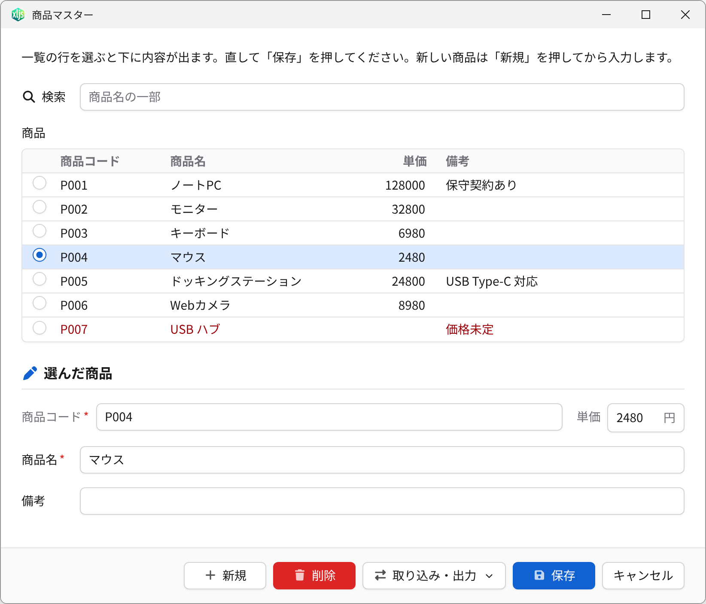
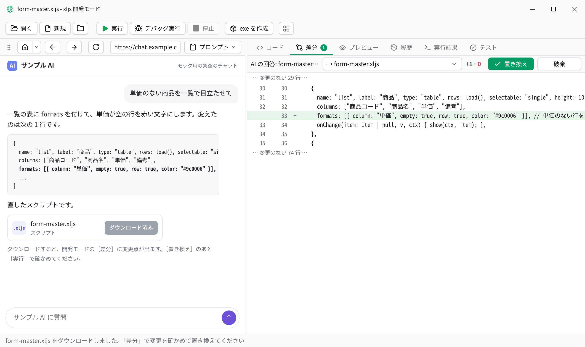
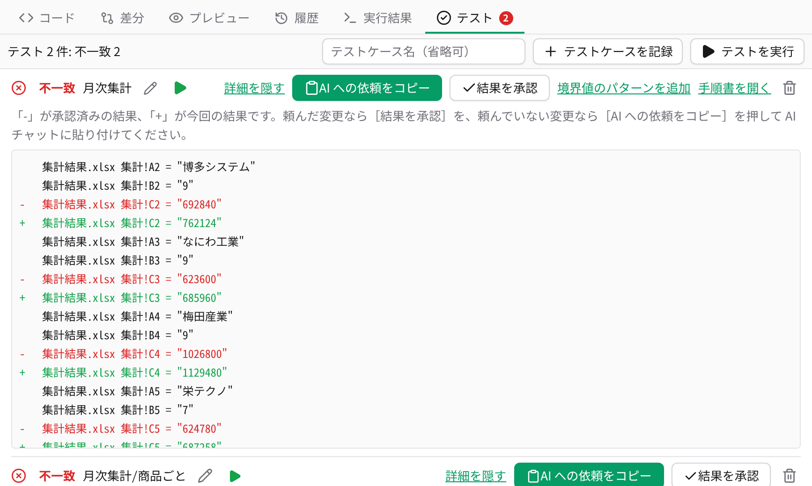
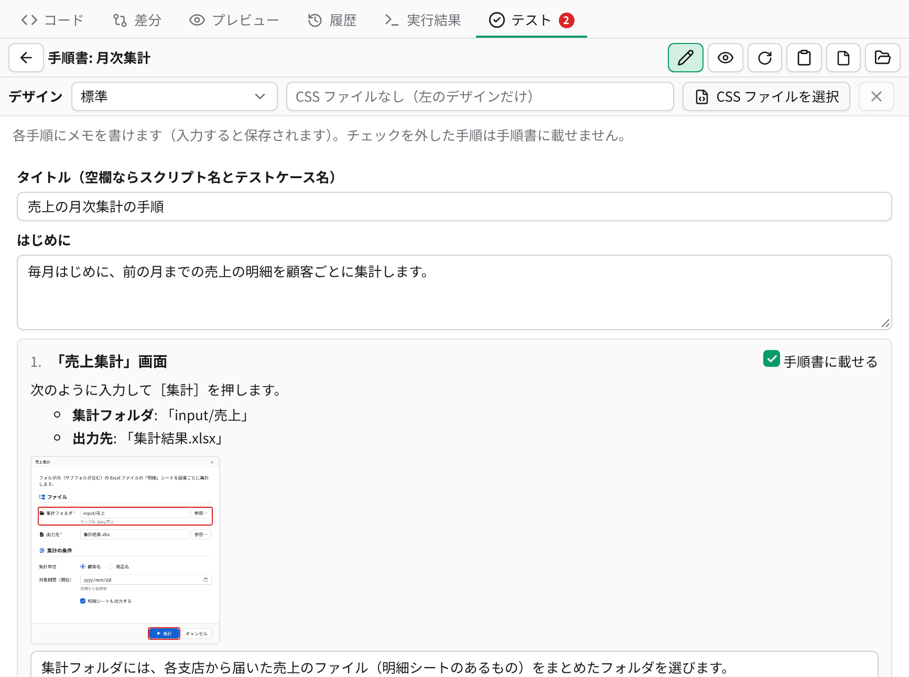

[日本語](README.md) | English

#  xljs

A tool for aggregating and transforming Excel and CSV data with JavaScript / TypeScript. With JS / TS alone you can build anything from a simple input-and-run form to a business app with list, search and entry screens. It is a single binary for Windows that needs no Excel and no setup.

> The user interface, messages and documentation are primarily in Japanese. English messages are available with `--lang=en`.



## Features

- **A single exe**: No installer and no Node.js. Place the exe next to your script and run it; finished scripts can be packed into the exe for distribution
- **No Excel or Acrobat required**: Read and write xlsx and calculate formulas, export PDFs with the same pages Excel prints, and merge PDFs, delete or rotate pages and add text, all on PCs without Excel or Acrobat
- **Development mode**: Put the AI chat you already use (Copilot, Gemini, ChatGPT, Claude, a local LLM chat, etc.) side by side with your script, review the diff of the answer, apply it and run it right there. The same screen shows error locations with a ready-made request for the AI, form previews and the history of applied changes
- **Simple tests and manuals**: Record what you did once, then replay the same operations after editing the script to check that the output has not changed. From the recorded operations you can also create a step-by-step manual with screenshots



<table>
<tr>
<td width="50%"></td>
<td width="50%"></td>
</tr>
<tr>
<td>Tests: differences between the approved result (-) and this run (+)</td>
<td>Manuals: created with screenshots from recorded operations</td>
</tr>
</table>

## Example script

Collects the "明細" (details) sheet of every Excel file in a folder into one workbook.

```js
const dir = await showDirectoryPicker();
if (!dir) exit();

const rows = [];
for (const h of ui.withProgress(dir.walk("*.xlsx"), { title: "集計中" })) {
  const book = excel.open(h);
  for (const r of book.sheets["明細"]?.toRowObjects() ?? []) rows.push({ ...r, ファイル: h.relativePath });
}

const dest = await showSaveFilePicker({ suggestedName: "集計結果.xlsx" });
if (dest) {
  const out = excel.create();
  out.addSheet("明細").write(rows);
  out.save(dest);
  alert(`${rows.length} 件を集計しました`);
}
```

- **Language**: ES2023-level JavaScript (optional chaining, `??`, async/await, top-level await, class fields, etc.) and TypeScript. Split code into files with `import`
- **Files**: Modeled on the browser's File System Access API (`showOpenFilePicker` / `FileSystemFileHandle`, etc.) plus extensions such as folder traversal
- **Excel**: Read and write xlsx and calculate formulas. Values are passed as numbers, strings, booleans and `Date`
- **PDF**: Export PDFs with the same pages Excel prints (WebView2); merge PDFs, delete, insert and rotate pages, and add text (no Excel or Acrobat required)
- **CSV / JSON**: Automatic detection of Shift_JIS (CP932) / UTF-8, writing UTF-8 with BOM, JSON Lines
- **Explorer integration**: Open Explorer with the output file selected, or open it in the default app
- **UI**: Native Windows dialogs (message boxes, file pickers, progress dialogs), forms (screens built without writing HTML, from input-and-run tools to apps with lists and entry screens), tables, charts, print preview and HTML screens (WebView2). Also works in a console
- **Other**: SQLite (including sharing on a file server), Web APIs (`fetch`), Active Directory, running programs, packing into an exe, extracting VBA macros and formulas

## Documentation (Japanese)

**Reference: https://cool0707.github.io/xljs/**

- [First steps](https://cool0707.github.io/xljs/guide/first-steps.html) — from download to running the samples and starting in development mode
- [The executable and its arguments](https://cool0707.github.io/xljs/guide/run.html) — commands and options
- [API](https://cool0707.github.io/xljs/api/globals.html) — explanations by feature and a reference generated from the type definitions
- [Samples](examples/README.md)
- [Writing scripts with an AI chat](docs/ai/README.md) — prompts and references to give to Claude, Gemini, Copilot, etc.
- [Developer notes](docs/development.md) — building, testing and documentation layout

## Download

Get [`xljs-windows-x64.zip`](https://github.com/cool0707/xljs/releases/latest/download/xljs-windows-x64.zip) (for ARM, [`xljs-windows-arm64.zip`](https://github.com/cool0707/xljs/releases/latest/download/xljs-windows-arm64.zip)) from the [latest release](https://github.com/cool0707/xljs/releases/latest), and drag and drop a script onto `xljs.exe` to run it. The `examples/` folder in the zip contains samples and data to try them with.

## License

Apache License 2.0 ([LICENSE](LICENSE)). The original Go version of xljs, from which this was ported, is under the MIT License.

Main libraries used: [umya-spreadsheet](https://github.com/MathNya/umya-spreadsheet) for reading and writing xlsx (via the fork [cool0707/umya-spreadsheet](https://github.com/cool0707/umya-spreadsheet) with fixes for Excel compatibility), QuickJS ([rquickjs](https://github.com/DelSkayn/rquickjs)) for running scripts, [oxc](https://github.com/oxc-project/oxc) for TypeScript transformation, [lopdf](https://github.com/J-F-Liu/lopdf) for PDF editing, and [rusqlite](https://github.com/rusqlite/rusqlite) for SQLite.

Bundled libraries: part of the formula engine [GridCraft](https://github.com/storytold/gridcraft) (MIT or Apache-2.0, `vendor/gridcraft`), Day.js (MIT, `src/api/dayjs/LICENSE`), Font Awesome Free (icons CC BY 4.0, fonts SIL OFL 1.1, CSS MIT, `src/ui/web/fontawesome/LICENSE.txt`), and AG Charts Community, Frappe Gantt, CodeMirror and others used in the screens ([`src/ui/web/vendor/VERSIONS.md`](src/ui/web/vendor/VERSIONS.md)).
