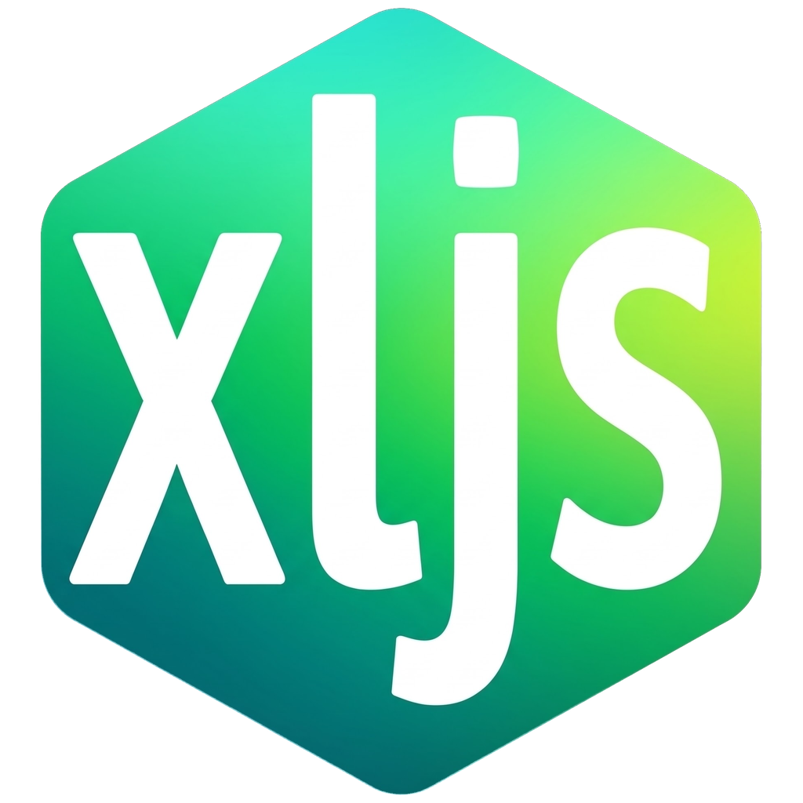

#  xljs

JavaScript / TypeScript で書いたスクリプトで Excel・CSV の集計やデータ変換を行う、Windows 用のシングルバイナリです。Excel のインストールは不要です。

```js
const dir = await showDirectoryPicker();
if (!dir) exit();

const rows = [];
for (const h of ui.withProgress(dir.walk("*.xlsx"), { title: "集計中" })) {
  const book = workbooks.open(h);
  for (const r of book.sheets["明細"]?.toObjects() ?? []) rows.push({ ...r, ファイル: h.relativePath });
}

const dest = await showSaveFilePicker({ suggestedName: "集計結果.xlsx" });
if (dest) {
  const out = workbooks.create();
  out.addSheet("明細").write(rows);
  out.save(dest);
  alert(`${rows.length} 件を集計しました`);
}
```

- **言語**: ES2023 相当（オプショナルチェーン、`??`、async/await、トップレベル await、クラスフィールドなど）と TypeScript。`import` でファイル分割可能
- **ファイル操作**: ブラウザの File System Access API 風（`showOpenFilePicker` / `FileSystemFileHandle` など）＋ フォルダ走査などの独自拡張
- **Excel**: xlsx の読み書き（[excelize](https://github.com/xuri/excelize)）。値は数値・文字列・真偽値・`Date` で受け渡し
- **CSV / JSON**: Shift_JIS(CP932) / UTF-8 の自動判定、BOM 付き UTF-8 での書き出し、JSON Lines
- **エクスプローラー連携**: 出力したファイルを選択した状態でエクスプローラーを開く、既定のアプリで開く
- **UI**: Windows ネイティブのダイアログ（メッセージボックス、ファイル選択、進捗ダイアログ）。コンソールでも動作

## 使い方

機能ごとのサンプルは [`examples/`](examples/README.md) にあります。AI チャット（Claude・Gemini・Copilot など）にスクリプトを書いてもらうときは、[`docs/ai/`](docs/ai/README.md) のプロンプトとリファレンスを最初に渡してください。

```
xljs [オプション] <script.js|script.ts> [引数...]
xljs pack <script> [-o 出力.exe]   スクリプトを埋め込んだ exe を作成
xljs check <script>                構文と import を検査（実行しない）
xljs init [フォルダ]               型定義 (xljs.d.ts) と jsconfig.json を作成
xljs version
```

| オプション | 説明 |
|---|---|
| `--ui=auto` | 既定。Windows ではネイティブダイアログ、それ以外はコンソール |
| `--ui=native` / `--ui=console` | UI を固定 |
| `--ui=mock --ui-answers=answers.json` | ダイアログを出さず、ファイルに書いた応答を返す（自動実行・テスト用） |
| `--lang=auto` / `ja` / `en` | メッセージの言語（既定はシステムの表示言語） |
| `--debug` | デバッグウィンドウでスクリプトを実行する（ブレークポイント・ステップ実行。下記「デバッグ」） |
| `--debug=window` | スクリプトは通常どおり実行し、画面（HTML ウィンドウ）の開発者ツール（F12）と右クリックメニューだけを有効にする |

- `xljs.exe` は GUI 版（ダブルクリックしても黒い窓が出ない）、`xljsc.exe` はコンソール版です。中身は同じで、GUI 版をコマンドプロンプトから起動した場合はそのコンソールに出力します（ただしコマンドプロンプトは終了を待たないので、コマンドラインで使うときや出力をリダイレクトするときはコンソール版の `xljsc` が向いています）。GUI 版で出力先がないときのエラーはダイアログで表示し、文字列を選択したり「コピー」ボタンでクリップボードにコピーしたりできます。
- エラー・警告はシステムの表示言語に合わせて日本語または英語で表示します。`--lang=ja|en`（または環境変数 `XLJS_LANG`）で切り替えられます。JavaScript エンジンや構文チェック、Excel 読み込み、OS のエラーのうちよく出るものは日本語に訳して表示します（`catch` で受け取る `e.message` は元のままです）。
- メッセージは言語ごとのファイル `internal/i18n/locales/<言語>.json` にまとまっています（`en.json` が基準）。言語を追加するときはファイルを 1 つ足してビルドするだけです（手順は同じフォルダの README.md）。
- 引数なしで起動すると、実行するスクリプトを選ぶダイアログが開きます。exe にスクリプトをドラッグ＆ドロップしても実行できます。
- コンソール版をダブルクリックで起動した場合は、終了時に Enter 待ちになります。
- 進捗表示中の Ctrl+C はキャンセル要求（`cancelled` が true になる）、2 回目で強制終了です。

### exe にする

```
xljs pack 集計.js            → 集計.exe
xljsc pack 集計.js -o 集計.exe （コンソール版をベースにする場合）
```

作成した exe に渡した引数（ドロップしたファイルのパスなど）は `xljs.args` で受け取れます。スクリプトはバンドル済みの状態で埋め込まれるので、`import` しているファイルも一緒に入ります。画面用の HTML・CSS・画像などは、メタデータの `@html` と `@assets` に書いたものが一緒に埋め込まれます。

### メタデータ（スクリプト先頭のコメント）

```js
// ==xljs==
// @mode    app            // console（既定）| app
// @html    ui/index.html  // 最初に開く HTML（スクリプトからの相対パス）
// @assets  ui/            // exe に同梱するフォルダ・ファイル（複数行可）
// @title   売上集計ツール  // ダイアログ・ウィンドウのタイトル（既定はスクリプト名）
// @size    960x640        // ウィンドウの大きさ
// @icon    ui/app.ico     // ウィンドウのアイコン（.ico か .png。exe にも同梱）
// @lang    ja             // メッセージの言語（--lang / XLJS_LANG が優先）
// ==/xljs==
```

- エントリのスクリプトの先頭（最初のコード行より前）の `//` コメントだけを読みます。知らないキーは警告を出して無視します。
- `@mode app` にすると、スクリプトの実行前に `@html` のページを表示するウィンドウ（`app.main`）が開き、ウィンドウを閉じるまでプロセスは終了しません。`app.open({ html, title, width, height })` で別のウィンドウも開けます（`await win.closed` で閉じるのを待てます）。画面とのやり取りは「[アプリ（HTML の画面）](#アプリhtml-の画面)」を参照。サンプル: `examples/app-hello/`、`examples/app-aggregate/`
- ウィンドウは Microsoft Edge WebView2 で表示します（Windows 10/11 には通常インストール済み）。ランタイムがない場合はダウンロードページを案内して終了します。ページは `https://app.xljs/` から配信され、見えるのは `@html` と `@assets` に書いたファイルだけです（pack した exe と同じ）。ほかの URL へのリンクは既定のブラウザで開きます。
- `@icon` を書くと、メインウィンドウ・`app.open` のウィンドウ・`ui.form` / `ui.table` のウィンドウのタイトルバーとタスクバーのアイコンがそのファイルになります（.ico は複数サイズ入りを推奨）。exe ファイル自体のアイコン（エクスプローラーでの表示）は変わりません。

### デバッグ

```
xljs --debug 集計.ts
```

デバッグウィンドウと WebView2 の開発者ツールが開きます。開発者ツールで Ctrl+P からスクリプトのファイル（TypeScript ならそのまま）を開いてブレークポイントを置き、［実行］（F5）を押します。ステップ実行、変数・式の確認、コンソールでの評価、例外での一時停止など、ブラウザの開発者ツールの機能がそのまま使えます。「実行の直前で一時停止する」をオンにすると、スクリプトの 1 行目に入る直前で止まります（F11 でステップイン）。

- `console.log` の出力は通常の出力先と開発者ツールのコンソールの両方に出ます。
- 終了後もウィンドウは残り、結果（終了コード・エラー）を表示します。［閉じる］で xljs が終了します。実行中にウィンドウを閉じるとスクリプトを中止します。
- 仕組み: デバッグ時だけ、prelude とスクリプトを goja ではなく WebView2（V8）のワーカーで動かし、ファイル・Excel・ダイアログなどの Go 側の処理はメッセージで中継します（ワーカーは `Atomics.wait` で応答を待つので、スクリプトからは同期の呼び出しに見えます）。そのため Go 側の処理 1 回ごとに往復が入り、セルを 1 つずつ大量に読み書きするスクリプトは通常より遅くなります。
- V8 は goja より機能が多いので、デバッグでは動くのに通常実行では動かないことがあります（`fetch` などワーカーで使えるブラウザの機能が見えてしまう、など）。最後は通常実行で確認してください。`Blob`・`File`・`TextEncoder`・`TextDecoder`・`Intl` は通常実行と同じ xljs のものに置き換えています。
- ネイティブ UI（Windows・WebView2）が必要です。コンソール UI やモック UI では `--debug=window` と同じ動作になります。埋め込み exe は環境変数 `XLJS_DEBUG=1`（または `window`）で同じことができます（元のソースは埋め込まれていないので、バンドル後のコードでのデバッグになります）。

### エディタの補完

```
xljs init
```

`xljs.d.ts` と `jsconfig.json` が作られ、VS Code で補完と型チェックが効くようになります。

## API

### ダイアログ・ピッカー

| API | 戻り値 |
|---|---|
| `alert(msg)` / `confirm(msg)` / `prompt(msg, 既定値)` | 同期。`prompt` はキャンセルで `null` |
| `await showOpenFilePicker({ multiple, types, startIn, title })` | `FileSystemFileHandle[]`（キャンセルで `[]`） |
| `await showSaveFilePicker({ suggestedName, types, startIn })` | `FileSystemFileHandle \| null` |
| `await showDirectoryPicker({ startIn, title })` | `FileSystemDirectoryHandle \| null` |

`types` は `[{ description: "Excel", accept: { "<MIME>": [".xlsx"] } }]` のほか、`accept: [".xlsx", ".xlsm"]` とも書けます。`showSaveFilePicker` で `types` を省略すると `suggestedName` の拡張子が種類になり、拡張子を消して入力しても付け足します（`集計` → `集計.xlsx`）。`startIn` には `"desktop"` `"documents"` `"downloads"`、パス、ハンドルを指定できます。

### 進捗表示

```js
const p = ui.progress({ title: "処理中", total: files.length });
for (const [i, f] of files.entries()) {
  if (p.cancelled) break;
  p.update(i, f.name);
  // ...
}
p.close();

// まとめて書く場合。キャンセルされるとスクリプトが終了する（終了コード 1）ので、途中までの結果で先へ進まない
for (const f of ui.withProgress(files, { title: "処理中" })) { /* ... */ }
// キャンセル後も続けたいときは onCancel: "break"（ループが終わるだけ。ui.cancelled で判定）
for (const f of ui.withProgress(files, { title: "処理中", onCancel: "break" })) { /* ... */ }
for await (const h of ui.withProgress(dir.values())) { /* 総数不明ならマーキー表示 */ }
```

Windows では標準の進捗ダイアログ（IProgressDialog）、コンソールでは標準エラー出力にバーを表示します。

### 入力フォーム（`ui.form`）

HTML を書かずに、項目の定義だけで入力フォームを出せます。キャンセルは `null`。

```js
const v = await ui.form({
  title: "売上集計",
  description: "フォルダ内の Excel を集計します",
  fields: [
    { name: "src",  label: "集計フォルダ", type: "folder", required: true },
    { name: "out",  label: "出力先", type: "saveFile", accept: [".xlsx"], default: "集計.xlsx" },
    { name: "mode", label: "集計単位", type: "select", options: ["顧客別", "商品別"] },
    { name: "tax",  label: "税込で集計", type: "checkbox" },
  ],
  submit: "実行",
  remember: true,            // 前回の値を %APPDATA%\xljs\<スクリプト名>.json に保存して次回の初期値にする
});
if (!v) exit();              // v.src は FileSystemDirectoryHandle、v.out は FileSystemFileHandle
```

- 項目の型: `text` `password` `number`（`min` `max` `step`）`date`（`Date`）`month` `time` `select` `radio`（`options`）`checkbox` `textarea` `file` `files` `folder` `saveFile` `table`。ファイル系は「参照…」ボタンとドラッグ＆ドロップで入力でき、値はハンドルになります（`folder` にファイルを落とすとそのフォルダ、`saveFile` にフォルダを落とすと入力済みのファイル名のままそのフォルダへの保存先になります）。
- `type: "table"` で表を表示します（`rows` `columns` は `ui.table` と同じ。`height` は表示する行数）。`selectable: true`（複数）/ `"single"` を付けると行をクリックして選べ、値は選んだ行（元のオブジェクト）になります。`selectable` なしは表示だけです。列見出しのクリックで並べ替えできます。`onSubmit` の中で `ctx.table(name, rows)` を呼ぶと行を入れ替えられます（結果の表示など）。
- `tabs: [{ label, fields }]` を指定するとタブで項目を切り替えて表示します（`fields` はタブの上に常に表示）。値はタブに関係なく 1 つのオブジェクトにまとまります。エラーのある項目のタブには印が付き、そのタブに切り替わります。Ctrl+Tab でも切り替えられます。サンプル: `examples/form-tabs-table.js`
- ウィンドウのアイコンはメタデータの `@icon` で変えられます（`@mode app` でなくても有効。表も同じ）。
- 検証: `required`、`pattern`（＋`patternMessage`）、`min` / `max`、ファイル・フォルダの存在。追加の検証は `validate(values)` で `{ 項目名: "メッセージ" }` か全体へのメッセージを返します。
- `onSubmit(values, ctx)` を書くと、実行後もウィンドウが開いたままになり、進捗（`ctx.progress(done, total, message)` / `ctx.withProgress(iterable)`。中止ボタンで `ctx.withProgress` のループから onSubmit が終わる）、ログ（`ctx.log` / `ctx.error`）、中止ボタン（`ctx.cancelled`）を表示します。出力ファイルを返すと完了後に「フォルダを開く」ボタンが出ます。サンプル: `examples/form-aggregate.js`
- `remember` ではパスワードは保存しません。保存したくない項目には `remember: false` を付けます。保存先のフォルダは環境変数 `XLJS_CONFIG_DIR` で変えられます。

### 表表示（`ui.table`）

PowerShell の `Out-GridView` のように、配列を表で表示します。列見出しのクリックで並べ替え、上の欄で絞り込み（空白区切りで AND）、列の境界のドラッグで幅を変更、Ctrl+C でコピー（タブ区切り）、CSV / Excel に保存できます。数十万行でも表示できます。

```js
ui.table(rows, { title: "集計結果", columns: ["顧客名", "件数", "合計"] });   // 表示のみ。すぐに戻る
await ui.table(rows).closed;                                                   // 閉じるまで待つ
const picked = await ui.table(files, { title: "処理するファイル", selectable: "multiple" });
// 選んだ行（元のオブジェクト）の配列。キャンセルは []。1 行だけなら selectable: "single"
```

`columns` は省略するとオブジェクトのキー（配列の行は A, B, C…）。`{ key, label, width }` でも指定できます。

行やセルのダブルクリックには `onDoubleClick` で処理を登録できます（ネイティブ UI のみ）。

```js
ui.table(files, {
  title: "ファイル一覧",
  onDoubleClick(e) {            // e: { row, index, column, key, value, close() }
    if (e.column === "更新日時") alert(`${e.row.名前} の更新日時: ${e.value}`);
    else shell.openPath(e.row.handle);
  },
});
```サンプル: `examples/table-file-list.js`

フォームと表はネイティブ UI では WebView2 のウィンドウ、コンソール（`--ui=console`）では対話入力と罫線の表で表示します。モック UI（`--ui=mock`）では応答ファイルの `"form": [{ 項目名: 値 }]`（既定値との差分。表の項目は選ぶ行の番号の配列。`null` でキャンセル）と `"table": [[0, 2]]`（選ぶ行の番号）を使います。

### アプリ（HTML の画面）

`@mode app`（または `app.open`）のウィンドウでは、画面（HTML）とスクリプトが関数呼び出し・イベント・共有の値でやり取りできます。画面の `xljs` オブジェクトは自動で使えるようになります（`<script>` の読み込みは不要）。

```js
// ==xljs==
// @mode   app
// @html   ui/index.html
// @assets ui/
// ==/xljs==
const win = app.main;

// export した関数は画面から呼べる（this は呼び出し元のウィンドウ）
export async function aggregate({ month }) {
  win.state.progress = 0;                 // 共有の値: 画面の data-bind に反映される
  // …
  await win.invoke("render", summary);    // 画面の関数を呼ぶ（xljs.handle）
  win.emit("done", { count: 10 });        // 画面へイベント（xljs.on）
  return summary.length;                  // 戻り値は画面の Promise に返る
}
win.on("hello", (name) => console.log(name)); // 画面からのイベント（xljs.emit）
win.$("#status").text("準備完了").addClass("ok"); // 簡易 DOM 操作（送りっぱなし）
const title = await win.$("h1").text();          // 読み取りは await
const size = await win.evaluate(() => [innerWidth, innerHeight]); // 関数を画面で実行
app.handle("dynamic", (x) => x * 2);       // export 以外の名前で登録
```

```html
<!-- ui/index.html -->
<progress data-bind="progress" max="100"></progress>   <!-- win.state.progress を表示 -->
<span data-bind="summary.total"></span>                 <!-- ネストした値も表示できる -->
<div data-show="done">完了しました</div>                  <!-- 値が真のときだけ表示（!done で逆） -->
<form data-action="aggregate" data-result="count">       <!-- 送信でフォームの値を渡して呼ぶ -->
  <input name="month" type="month" required>
  <button>集計</button>
</form>
<input type="checkbox" data-model="tax">                 <!-- 入力と win.state.tax を双方向に同期 -->
<button data-action="cancel">中止</button>               <!-- フォーム外: 引数なし（data-args='[1,"a"]' で指定） -->
<script>
  xljs.handle("render", (rows) => { /* 表を描く */ return rows.length; });
  xljs.on("done", (r) => console.log(r.count));
  document.querySelector("#drop").addEventListener("drop", (e) => {
    e.preventDefault();
    xljs.invoke("load", e.dataTransfer.files);  // ファイルはスクリプトで実パス付きのハンドルになる
  });
</script>
```

- 画面→スクリプトの呼び出しは常に非同期（`await xljs.invoke(...)`）。スクリプト→画面は、読み取り（`invoke` `evaluate` `$().text()` など）は `await`、書き込み（`state` `emit` `$().text(v)` など）は送りっぱなしで、送った順に反映されます。ページの読み込み前に送ったものは読み込み後に届きます。
- 受け渡せる値は JSON の値と `Date`、ファイル/フォルダのハンドル、`ArrayBuffer`、`Error` です。画面で選んだ・ドロップしたファイル（`File`）はスクリプトで `FileSystemFileHandle`、ドロップしたフォルダは `FileSystemDirectoryHandle` になります（WebView2 113 以降）。
- `win.state` / `xljs.state` は最上位のキーだけ同期します（`win.state.summary = {...}` のように代入し直す）。相手側で値が変わると `on("state", (key, value) => ...)` が呼ばれます。
- `data-action` の関数がエラーになると、エラーのダイアログを表示します（スクリプトは続行）。`xljs.invoke` のエラーは Promise の reject で、`catch` しなければ同じくダイアログになります。スクリプトの `win.on` / `$().on` のハンドラのエラーも同様です。
- `win.$(sel).on(type, (e) => ...)` の `e` は DOM イベントではなく値（`type` `id` `name` `value` `checked` `dataset` `key`、submit ならフォームの値 `values`）。`{ preventDefault: true }` で既定の動作を止めます。
- `data-action` の実行中は要素が無効になり、`xljs-busy` クラスが付きます。

モック UI では応答ファイルの `"app"` にウィンドウごとの操作の列を書くと、画面の代わりに実行してログに出します（サンプル: `testdata/scripts/bridge.test.answers.json`）。

```json
{ "app": [[
  { "invoke": "aggregate", "args": [{ "month": "2026-04" }], "expect": 3 },
  { "emit": "hello", "args": ["画面"] },
  { "state": { "tax": true } },
  { "event": "click", "selector": "#run" },
  { "handle": "render", "result": 3 },
  { "close": true }
]] }
```

### ファイル・フォルダ

```js
const h = fs.file("C:\\data\\a.xlsx");        // FileSystemFileHandle（存在確認なし）
const d = fs.dir("C:\\data");                  // FileSystemDirectoryHandle
const file = await h.getFile();                // File（name, size, path, text(), arrayBuffer()）

for (const f of d.walk({ glob: "*.xlsx", exclude: ["old"] })) {
  console.log(f.relativePath);                 // サブフォルダも走査
}
```

- `walk()` のパターンは `"/"` を含まなければ任意の階層のファイル名に一致し、含めば起点からの相対パスに一致します（`**` 可、大文字小文字は区別しない）。除外パターンにフォルダが一致すると中身ごと除外します。
- `walk()` `list()` `fs.list()` `fs.glob()` `entries()` / `values()` は、既定で隠しファイル・システムファイル（`desktop.ini`、`Thumbs.db` など）、`.` で始まる名前、Office のロックファイル（`~$集計.xlsx`）を除きます（隠しフォルダは中も見ません）。含めるときは `{ hidden: true }` を渡します（`fs.list(p, { hidden: true })`、`d.list({ hidden: true })`）。
- ハンドルの独自拡張: `path`, `relativePath`, `exists()`, `readText()`, `writeText()`, `readBytes()` など
- `fs`: `exists` `stat` `readText` `writeText` `appendText` `readBytes` `writeBytes` `readJSON` `writeJSON` `list` `walk` `glob` `mkdir` `remove` `rename` `copy` `cwd` `chdir`
- `path`: `join` `resolve` `dirname` `basename` `extname` `relative` `normalize` `isAbsolute`
- パスを受け取る API には文字列・ハンドル・`File`（ディスク上のもの）のどれでも渡せます。
- 相対パスはカレントフォルダが基準です。エクスプローラーから起動した場合（ダブルクリック、exe やスクリプトへのドロップ）はスクリプト（埋め込み exe なら exe）のあるフォルダがカレントフォルダになります。コマンドプロンプトから起動した場合はそのままです。
- `writeText` / `appendText` の既定は UTF-8 で、`.csv` / `.tsv` のファイルだけは BOM 付き（Excel で文字化けしない）にします。
- 文字コード: `"auto"`（BOM → UTF-8 → CP932 の順に判定）, `"utf8"`, `"utf8bom"`, `"cp932"`（= `"shift_jis"`）, `"euc-jp"`, `"utf16le"` など。CP932 で表せない文字は `?` になります。

### CSV

```js
const rows = csv.read(h);                         // 見出し行をキーにしたオブジェクトの配列。数値・日付・真偽値は変換、空欄は null
const grid = csv.read("a.tsv", { header: false });// 2 次元配列（.tsv はタブ区切り）
const text = csv.read(h, { cast: false });        // 変換せず、すべて文字列のまま

csv.write("out.csv", rows);                       // 既定は BOM 付き UTF-8・CRLF
csv.write("out.csv", rows, { encoding: "cp932", columns: ["日付", "金額"] });
csv.parse(text) / csv.stringify(rows)
```

- 値の変換（既定）: `1234`・`-2.5`・`"1,234"` は数値、`2026/4/1`・`2026-04-01 09:30` は `Date`、`TRUE`/`FALSE` は真偽値、空欄は `null`。Excel で開いたときに近い結果ですが、`00123` のように先頭が 0 のコード、16 桁以上の数字、`123-4567` などは文字列のままです。
- 見出しの前後の空白は取り除きます（`"金額 "` も `r.金額` で読めます）。

### JSON

```js
const data = fs.readJSON(h);                          // パス・ハンドル・File・Blob。BOM・CP932 も自動判定
const withDates = fs.readJSON(h, { dates: true });    // ISO 形式の日時文字列を Date に戻す
fs.writeJSON("out.json", rows);                       // 2 スペースでインデント、UTF-8
fs.writeJSON("out.json", rows, { space: 0, encoding: "cp932", dates: "iso" });
fs.readJSONL("log.jsonl") / fs.writeJSONL("log.jsonl", rows, { append: true })
import master from "./master.json";                   // import でも読める（exe に埋め込まれる）
```

- `Date` は既定でローカル時刻＋オフセット（`2026-04-01T09:00:00+09:00`）で書き出します。`dates: "iso"` で `JSON.stringify` と同じ UTC 表記になります。
- 解析エラーはファイル名（JSON Lines は行番号も）付きで表示します。

### エクスプローラー・既定のアプリ

```js
shell.showItemInFolder(dest);                 // 保存したファイルを選択した状態でエクスプローラーを開く
shell.showItemInFolder([a, b, c]);            // 複数選択（フォルダが違えばフォルダごとに開く）
shell.openPath("集計.xlsx");                  // 既定のアプリ（Excel など）で開く
shell.openPath(dir);                          // フォルダを開く
shell.openExternal("https://example.com/");   // ブラウザで開く
```

パス・ハンドル・`File` のどれでも渡せます。mock UI では実際には開かず、ログに出すだけです。

### Excel

```js
const book = workbooks.open(h);              // パス・ハンドル・File・Blob
const sheet = book.sheets["売上"] ?? book.sheets[0]; // 名前は大文字小文字・前後の空白・全角半角の違いも許す
const rows = sheet.toObjects();              // [{ 日付: Date, 金額: 1200, ... }]
const grid = sheet.toArrays({ text: true }); // 表示形式を適用した文字列

sheet.cell("B2").value = 100;
sheet.cell(3, 2).value = new Date();         // (行, 列)
sheet.cell("C10").formula = "=SUM(C2:C9)";
sheet.append([{ 日付: new Date(), 金額: 500 }]);
book.save();                                 // 上書き（save(パスやハンドル) で別名保存）

const out = workbooks.create();
out.addSheet("集計").write(summary).setColumnWidth("A:C", 16);
out.save("集計.xlsx");
```

- 新しいブック（`workbooks.create()`）の既定フォントは表示言語に合わせます（日本語では Excel と同じ游ゴシック）。`workbooks.create({ font: "Meiryo UI" })` で変更できます。
- 日付の書式が付いた数値セルは `Date` になります（Excel の日付はタイムゾーンを持たないので、ローカル時刻として扱います）。
- 数式は保存時に「開いたときに再計算」フラグを立てるので、Excel で開けば計算結果が表示されます。スクリプト内で値が必要なら `cell.calc()`（対応関数は一部）。
- xlsx / xlsm に対応しています（旧形式の .xls は不可）。マクロ、ピボットテーブル、グラフなどは読み書きの過程で失われることがあります。

### 書式（フォント・罫線・塗りつぶしなど）

```js
// 表の体裁をまとめて付ける（見出しの太字・塗り・罫線、列幅自動、先頭行固定、フィルター）
sheet.write(rows, { table: true, columnStyles: { 金額: { format: "#,##0" } } });

// 範囲・セル単位（指定した項目だけが既存の書式に上書きされる）
sheet.style("A1:D1", { bold: true, color: "#FFFFFF", background: "#305496", align: "center" });
sheet.cell("D10").style({ font: { size: 14, bold: true }, format: "¥#,##0", border: { top: "double" } });
sheet.range("A3:D10").border({ outline: "medium", inside: { style: "thin", color: "#BFBFBF" } });

sheet.merge("A1:D1");          // セル結合
sheet.freeze("A2");            // 1 行目を固定（freeze({ rows: 1, columns: 1 }) も可）
sheet.autoFilter("A3:D10");    // フィルター
sheet.autoFit();               // 列幅を内容に合わせる（全角は 2 文字分）
sheet.setRowHeight(1, 30);
sheet.cell("A1").getStyle();   // 現在の書式を取得
```

| 項目 | 指定方法 |
|---|---|
| `font` | `{ name, size, bold, italic, underline, strike, color, vertAlign }` |
| `fill` | `"#RRGGBB"`（`null` で塗りなし） |
| `border` | `"thin"` など（全セルの上下左右）、または `{ all, outline, inside, horizontal, vertical, top, bottom, left, right, diagonalUp, diagonalDown }`。各辺は `"thin"` `"medium"` `"thick"` `"double"` `"dashed"` `"dotted"` `"hair"` など、または `{ style, color }` |
| `alignment` | `{ horizontal, vertical, wrap, shrink, indent, rotation }` |
| `numberFormat` | `"#,##0"` `"yyyy/m/d"` `"0.0%"` `"¥#,##0"` など（`"General"` で標準） |
| 省略形 | `bold` `italic` `underline` `strike` `color` `fontSize` `fontName` `background` `align` `valign` `wrap` `format` |

- 色は `"#RRGGBB"`・`"#RGB"`・`red` などの色名で指定します。
- 既定では既存の書式にマージします。`{ replace: true }` を渡すと書式を置き換えます。
- 範囲の端に引いた罫線は、隣の（書式が設定済みの）セルの接する辺にも反映するので、線が食い違いません。
- サンプル: `examples/xlsx-style-report.js`

### 日付（Day.js）

[Day.js](https://day.js.org/) を組み込んでいます（グローバルの `dayjs`。`import` は不要）。日本語ロケールと主なプラグイン（customParseFormat, isBetween, isSameOrAfter / isSameOrBefore, minMax, quarterOfYear, weekOfYear, isoWeek, dayOfYear, duration, relativeTime, advancedFormat, isLeapYear, isToday など）を読み込み済みです。

```js
const d = dayjs(r.日付);                       // Date・"2026/4/1"・"2026-04-01"（文字列はローカル時刻）
d.format("YYYY年M月D日(ddd)");                // "2026年4月1日(水)"
d.add(1, "month").endOf("month");              // 翌月末
dayjs(b).diff(a, "day");                       // 日数の差
dayjs("20260401", "YYYYMMDD");                 // 形式を指定して読む
dayjs.fromExcel(45383);                        // Excel の日付シリアル値 → 2024/4/1（xljs 拡張）
sheet.cell("A1").value = dayjs();              // dayjs の値はセル・CSV・JSON・表にそのまま渡せる（Date として扱う）
```

- ロケールは PC の表示言語によらず日本語です（`dayjs.locale("en")` で英語）。
- Day.js は MIT ライセンスです（`internal/api/dayjs/LICENSE`）。

### その他

- `console.log/error/table/time` など、`setTimeout` / `setInterval`、`sleep(ms)`
- `fs.readJSON` などのほか、`csv.read` / `workbooks.open` もパス・ハンドル・`File`・`Blob` を受け付けます
- `xljs.args` `xljs.script` `xljs.scriptDir` `xljs.version` `xljs.title`（ダイアログのタイトル。`@title` で変更可） `xljs.env(name)` `exit(code)`
- 補っている組み込み: `Array.fromAsync`, `structuredClone`, `TextEncoder` / `TextDecoder`（Shift_JIS 対応）, `atob` / `btoa`, `Blob` / `File`, 数値・日付の `toLocaleString`（日本語形式）, 簡易 `Intl`

## ビルド

Go 1.26 以降が必要です（cgo 不要）。

```
# Windows x64 版（どの OS からでもクロスビルド可。Go では x64 を amd64 と呼びます）
GOOS=windows GOARCH=amd64 go build -trimpath -ldflags "-s -w -H=windowsgui" -o dist/x64/xljs.exe ./cmd/xljs
GOOS=windows GOARCH=amd64 go build -trimpath -ldflags "-s -w" -o dist/x64/xljsc.exe ./cmd/xljs

# または
make windows        # dist/x64/
make dist           # dist/xljs-windows-x64.zip と xljs-windows-arm64.zip
```

Windows 上なら PowerShell で `go build -o xljsc.exe ./cmd/xljs`（GUI 版は `-ldflags -H=windowsgui` を付けて `xljs.exe`）だけでも構いません。`cmd/xljs/rsrc_windows_*.syso` はアイコン（`assets/xljs.ico`、16〜256px）と、ビジュアルスタイル・高 DPI 対応のマニフェストのリソースです。作り直すときは次のようにします。

```
python3 tools/make_icon.py ロゴ.png          # assets/xljs.png と assets/xljs.ico を生成（背景を透過）
go run github.com/akavel/rsrc@latest -manifest cmd/xljs/xljs.manifest -ico assets/xljs.ico -arch amd64 -o cmd/xljs/rsrc_windows_amd64.syso
go run github.com/akavel/rsrc@latest -manifest cmd/xljs/xljs.manifest -ico assets/xljs.ico -arch arm64 -o cmd/xljs/rsrc_windows_arm64.syso
```

## 開発

```
go test ./...
```

- `testdata/scripts/*.test.{js,ts}` はモック UI で実行される結合テストです。`*.answers.json` に応答を書きます。
- UI はインターフェースで分離しているので、ネイティブダイアログ以外のロジックは Linux でもテストできます。
- スクリプトは専用のスレッドで動き、メインスレッドが UI（ダイアログ・ウィンドウのメッセージループ）を受け持ちます（`ui.Run`）。重い処理の間もウィンドウが固まりません。

| パス | 内容 |
|---|---|
| `cmd/xljs` | CLI（引数処理、exe 埋め込み、コンソール処理） |
| `internal/engine` | esbuild でバンドル → goja で実行、イベントループ、エラー表示 |
| `internal/api` | Go 側のネイティブ関数と `prelude.js`（公開 API の JS 実装） |
| `internal/i18n` | メッセージの多言語化（`locales/*.json` を埋め込み） |
| `internal/ui` | UI インターフェースと native（Win32・WebView2）/ console / mock 実装、UI スレッド |
| `internal/pack` | exe へのスクリプト・アセット埋め込み（zip） |
| `internal/meta` | スクリプト先頭のメタデータの読み取りとアセットの範囲 |
| `types/xljs.d.ts` | 型定義（`xljs init` で出力） |

スクリプトは esbuild で 1 ファイルにバンドルし（TypeScript の変換、goja 未対応構文の変換、ソースマップ付き）、`async` 関数で包んで [goja](https://github.com/dop251/goja) で実行します。エラーの行番号は元のファイルの位置で表示されます。`--debug` のときだけはデバッグウィンドウ（WebView2）のワーカーで実行し、ネイティブ関数を Go 側からメッセージで提供します（`internal/api/remote.go`、`internal/engine/debug.go`、`internal/ui/web/debug*.js`）。

## ライセンス

MIT
