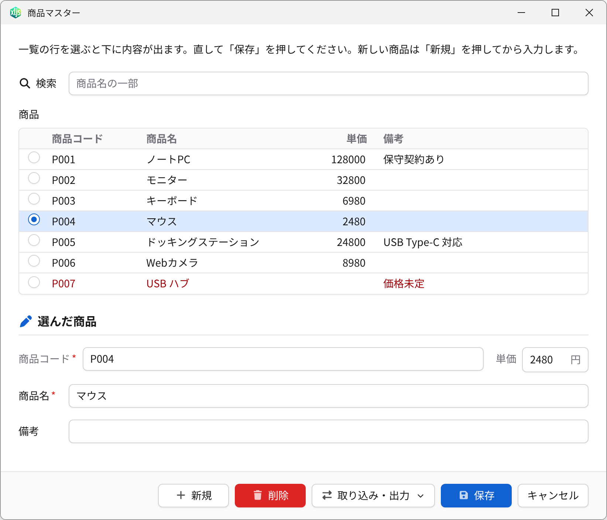
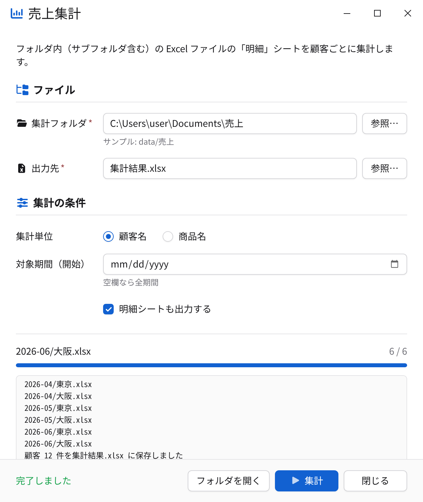
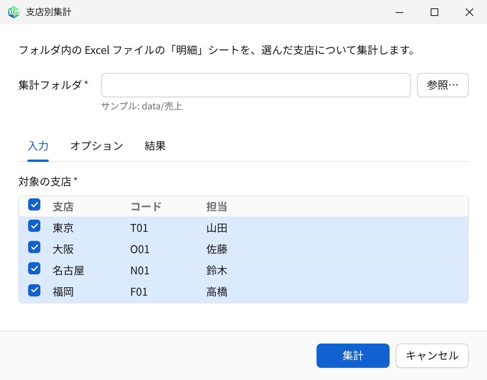

HTML を書かずに、項目の定義だけで画面を作れます。フォームは入力のダイアログではなく、入力欄・表・グラフ・ボタン・タブを置ける画面で、処理のあとも開いたまま続けて使えます（Excel VBA のユーザーフォームや C# のフォームアプリに当たります）。同じ `ui.form` で、次のどちらも作れます。

| 作るもの | 画面 | 書き方 |
|---|---|---|
| **ツール**（入力して実行する） | 入力欄と実行ボタン。実行すると進捗・ログ・結果が同じ画面に出る | 処理を実行ボタン（`buttons` の `onClick`）に書く |
| **アプリ**（開いたまま使う） | 開くと一覧が出ている。検索・追加・更新・削除・出力ができ、操作のたびに一覧が最新になる | 一覧は `table` 項目、操作は `buttons`、連動は `onChange`。機能ごとに画面を分けるなら [`ui.forms`](#複数のフォームをまとめるuiforms) |

<figure class="shot"><figcaption>開いたまま使うアプリの例（examples/form-master.xljs）。一覧から選んだ商品を下の欄で直して保存します。</figcaption></figure>

フォームにない見た目・操作（表のセルに打ち込みながら行を増やす明細、独自のレイアウト）が要るときは [カスタムアプリ](app.md)（HTML の画面）にします。

## 入力して実行する（ツール）

`buttons` に `onClick(values, form)` のあるボタンを置くと、押したあともウィンドウは開いたままで、進捗・ログ・中止ボタンを表示します。`variant: "primary"` のボタンは Enter でも押されます。処理が終わると入力できる状態に戻り、値を変えて続けて実行できます。サンプル: `examples/form-aggregate.xljs`

```js
await ui.form({
  title: "売上集計",
  description: "フォルダ内の Excel を集計します",
  fields: [
    { name: "src",  label: "集計フォルダ", type: "folder", required: true },
    { name: "out",  label: "出力先", type: "saveFile", accept: [".xlsx"], default: "集計.xlsx", required: true },
    { name: "mode", label: "集計単位", type: "select", options: ["顧客別", "商品別"] },
    { name: "tax",  label: "税込で集計", type: "checkbox" },
  ],
  remember: true,            // 前回の値を %APPDATA%\xljs\<スクリプト名>.json に保存して次回の初期値にする
  buttons: [{ label: "実行", icon: "play", variant: "primary",
    async onClick(v, form) {  // v.src は FileSystemDirectoryHandle、v.out は FileSystemFileHandle
      const files = v.src.walk("*.xlsx").toArray();
      for (const h of form.withProgress(files)) {  // 進捗をフォームに表示。中止ボタンでここから onClick が終わる
        form.log(h.relativePath);                  // ログ欄に 1 行（form.error で赤字）
      }
      return v.out;           // 出力ファイルを返すと「フォルダを開く」ボタンが出る
    } }],
});
```

<figure class="shot"><figcaption>入力して実行するツールの例（examples/form-aggregate.xljs）。［集計］を押すと、同じ画面に進捗とログが出ます。終わったあとも開いたままなので、条件を変えて続けて実行できます。</figcaption></figure>

## 開いたまま使う（アプリ）

一覧を出しておき、行の選択やボタンで処理して、同じ画面の一覧を読み直します。データを次回に持ち越すなら [SQLite](sqlite.md) に置きます。

```js
// 商品マスター: 一覧から選ぶと下の入力欄に出る。保存・削除のたびに一覧を読み直す
const db = sqlite.open(path.join(xljs.scriptDir, "商品.db"));
db.exec("CREATE TABLE IF NOT EXISTS 商品 (コード TEXT PRIMARY KEY, 品名 TEXT NOT NULL, 区分 TEXT, 単価 INTEGER)");
const load = (word) => db.all("SELECT * FROM 商品 WHERE 品名 LIKE ? ORDER BY コード", `%${word ?? ""}%`);
const show = (form, r) => {   // 入力欄に 1 件を出す（r なしは空にする）
  form.setValue("code", r?.コード ?? "");
  form.setValue("name", r?.品名 ?? "");
  form.setValue("kind", r?.区分 ?? "製品");
  form.setValue("price", r?.単価 ?? null);
};

await ui.form({
  title: "商品マスター",
  width: 760,
  fields: [
    { name: "word", label: "検索", placeholder: "品名の一部", onChange(word, v, form) { form.table("list", load(word)); } },
    { name: "list", label: "商品", type: "table", rows: load(), columns: ["コード", "品名", "区分", "単価"], selectable: "single", height: 320,
      onChange(row, v, form) { show(form, row); } },   // 行を選ぶと入力欄に出す
    { group: "選んだ商品（新しい商品は「新規」を押して入力）", fields: [
      { row: "", fields: [
        { name: "code", label: "コード", required: true, pattern: "[A-Z]\\d{3}", patternMessage: "英大文字 1 字と数字 3 桁で入力してください" },
        { name: "kind", label: "区分", type: "select", options: ["製品", "部品", "消耗品"], default: "製品" },
        { name: "price", label: "単価", type: "number", min: 0, suffix: "円", required: true },
      ] },
      { name: "name", label: "品名", required: true },
    ] },
  ],
  buttons: [                 // Enter で押されるのは primary の「保存」
    { label: "新規", icon: "plus", validate: false, onClick(v, form) { show(form); } },
    { label: "削除", icon: "trash", variant: "destructive", validate: false, confirm: "選んだ商品を削除しますか？",
      onClick(v, form) {
        if (!v.list) throw new Error("削除する商品を一覧から選んでください");
        db.run("DELETE FROM 商品 WHERE コード = ?", v.list.コード);
        form.log(`${v.list.コード} ${v.list.品名} を削除しました`);
        form.table("list", load(v.word));
        show(form);
      } },
    { label: "保存", icon: "floppy-disk", variant: "primary",
      onClick(v, form) {      // 同じコードがあれば更新、なければ追加
        db.run("INSERT OR REPLACE INTO 商品 VALUES (?, ?, ?, ?)", v.code, v.name, v.kind, v.price);
        form.log(`${v.code} ${v.name} を保存しました`);
        form.table("list", load(v.word));
      } },
  ],
});
db.close();
```

アプリを組み立てる部品:

- **一覧**: `type: "table"` の項目。開いたときに出しておく行は `rows`、あとから入れ替えるのは `form.table(name, rows)`（ボタンの `onClick`・項目の `onChange` のどちらからでも）。1 件もないときにも見出しが出るように、列は `columns` に書いておきます。`selectable: "single"` なら行を選ぶたびに `onChange(row, values, form)` が呼ばれます。`editable: true` で表の上でそのまま直せます。
- **操作**: `buttons` に動作ごとのボタンを並べます（`variant` で見た目、`confirm` で実行前の確認、`validate: false` で検証なし、数が多ければ `menu`）。Enter で押すボタンには `variant: "primary"`（1 つまで。なければ Enter では何も押されません）。右上には `toolbar`。
- **連動**: 項目の `onChange` で `form.setValue`（ほかの項目を埋める）、`form.table`（絞り込み）、`form.setDisabled` / `form.setHidden`（出し分け）。
- **結果**: 経過と件数は `form.log`、グラフは `chart` 項目と `form.chart`、できたファイルは `return`。
- **画面の分け方**: 項目が多ければ `tabs` とグループ、機能ごとに画面を分けるなら [`ui.forms`](#複数のフォームをまとめるuiforms)（サイドメニュー）。

サンプル: `examples/form-master.xljs`（一覧から選んで追加・更新・削除）、`examples/form-tabs-table.xljs`（タブと表）、`examples/chart-gantt.xljs`（フォームの中のガントチャート）

## 尋ねて閉じる

`buttons` を省くと「OK」ボタンだけのフォームになり、押すと閉じて値を返します（キャンセルは `null`）。ボタンの文字を変えるなら、`onClick` のないボタンを置きます（押すと同じく閉じて値を返します）。処理の途中で少し尋ねるだけのときに使います。

```js
const v = await ui.form({
  title: "出力の設定",
  fields: [
    { name: "out",  label: "出力先", type: "folder", required: true },
    { name: "tax",  label: "税込で出力", type: "checkbox" },
  ],
  buttons: [{ label: "決定", variant: "primary" }],   // onClick がないので押すと閉じる
});
if (!v) exit();              // v.out は FileSystemDirectoryHandle
```

## 項目とオプション

項目の `type` ごとに、値の型と使えるキーが決まっています。

| type | 値 | その type のキー |
|---|---|---|
| `text`（省略時）`password` | 文字列 | `placeholder` `prefix` `suffix` `maxLength` `pattern` `patternMessage` |
| `textarea` | 文字列 | `placeholder` `maxLength` `pattern` `patternMessage` `lines`（行数。既定 4） |
| `number` | 数値か `null` | `min` `max` `step` `placeholder` `prefix` `suffix` |
| `slider` | 数値 | `min` `max`（既定 0〜100）`step` `prefix` `suffix` |
| `date` `month` `time` | `Date` / `"2026-04"` / `"09:30"` か `null` | `placeholder` |
| `dateRange` | `{ from, to }` か `null` | |
| `select` | 選んだ値（文字列） | `options` `placeholder`（未選択の表示） |
| `radio` | 選んだ値 | `options` |
| `checkbox` `switch` | `true` / `false` | |
| `checkboxes` | 選んだ値の配列 | `options` |
| `segmented` | 選んだ値（`multiple: true` なら配列） | `options` `multiple` |
| `combobox` | 選んだ値（`allowCustom: true` なら入力した文字列も） | `options` `allowCustom` `placeholder` `pattern` `patternMessage` |
| `tags` | 文字列の配列 | `placeholder` `maxLength` `pattern` `patternMessage`（1 つずつ） |
| `file` `folder` `saveFile` | ハンドルか `null` | `accept` `placeholder` |
| `files` | ハンドルの配列 | `accept` `placeholder` `lines`（行数。既定 3） |
| `table` | 選んだ行（下） | `rows` `columns` `formats` `selectable` `editable` `validateRow` `height`（px） |
| `chart` | なし | `chart`（[グラフ](chart.md) の定義）`height`（px。既定 300） |
| `note` | なし | `text`（本文）`kind`（`"info"` `"success"` `"warning"` `"error"`） |
| `image` | なし | `src` `width` `height`（px）`align` `alt`（下） |

どの項目にも `name` `label` `icon` `help` `tooltip` `disabled` `hidden` を、値のある項目には `default` `required` `validate` `onChange` `remember` を書けます。type に合わないキー（`text` の `options` など）や、ないキーを書くとエラーになります。`options` は文字列か `{ value, label }` の配列です。

- ファイル系は「参照…」ボタンとドラッグ＆ドロップで入力でき、値はハンドルになります（`folder` にファイルを落とすとそのフォルダ、`saveFile` にフォルダを落とすと入力済みのファイル名のままそのフォルダへの保存先になります）。
- `type: "table"` で表を表示します（`rows` `columns` は `ui.table` と同じ。`height` は高さ（px。既定は 8 行分まで））。`selectable: true`（複数）/ `"single"` を付けると行をクリックして選べ、値は選んだ行（元のオブジェクト）になります。`selectable` なしは表示だけです。列見出しのクリックで並べ替えできます（列幅は最初に表示したときのまま変わりません）。列見出しのボタンから列ごとのフィルタ、列の固定（左端・右端・この列まで）、列の表示・非表示、境界のドラッグで幅の変更ができ、`formats` で条件付き書式、列の `format` で `#,##0"円"` のような Excel の表示形式を付けられます（いずれも [テーブル](table.md) と同じ。編集できるセルは入力中だけもとの値を表示）。ボタンの `onClick` の中で `form.table(name, rows)` を呼ぶと行を入れ替えられます（結果の表示など）。
- `editable: true`（または列ごとに `columns: [{ key, editable: true }]`）でセルをその場で編集できます。列に `type`（`text` `number` `date` `month` `time` `select` `combobox` `checkbox`。既定は値から判断）、`required` `min` `max` `pattern` `options`（`select` と `combobox` のセルは入力した文字を含む選択肢に絞り込んで一覧に出します。選択肢に空欄は書かず（`""`）、入力を消すとセルが空になります。選択肢にない入力は `combobox` の `allowCustom: true` のときだけ受け付けます）、`validate(value, row, index)` を書くと入力のたびに検証し、エラーのセルを赤く表示して表の下に一覧を出します（クリックでそのセルへ）。行全体の検証は項目の `validateRow(row, index)`。エラーが残っているとボタン（`validate: false` のものを除く）を実行できません。検証を通った値は元の行オブジェクトに直接書き込まれます。Enter で下のセルへ移ります。数値は全角数字や「1,000」も受け付けます。コンソールでは表のあとに編集する行の番号を尋ねます。
- `fields`（タブの `fields` でも可）に `{ group: "見出し", icon, help, fields: [...] }` を項目と並べて書くと、見出しの下に項目をまとめて表示します。値はグループに関係なく 1 つのオブジェクトにまとまります（グループの中にグループは入れられません）。コンソールでは `-- 見出し --` を出してから順に尋ねます。
- `fields`（タブ・グループの `fields` でも可）に `{ row: "氏名", fields: [...] }` を書くと、`row` を左のラベルにして項目を横に並べます（姓・名、郵便番号と都道府県など）。各項目の `label` は入力欄の前に小さく出ます（`""` で出しません）。幅は等分で、`maxLength` や数値の項目はその幅になります。値はほかの項目と同じく 1 つのオブジェクトにまとまります。

```js
const v = await ui.form({
  title: "顧客登録",
  fields: [
    { row: "氏名", fields: [{ name: "last", label: "姓", required: true }, { name: "first", label: "名", required: true }] },
    { row: "フリガナ", fields: [{ name: "lastKana", label: "", placeholder: "セイ" }, { name: "firstKana", label: "", placeholder: "メイ" }] },
  ],
});
```

- `type: "image"` で画像を表示します。`src` に画像ファイル（PNG・JPEG・GIF・BMP・WebP・ICO・SVG のパス・ハンドル）、バイト列（`Uint8Array`）、`"https://..."` の URL を指定します。`width` / `height`（px。片方だけなら縦横比を保つ）、`align`（`"left"` `"center"` `"right"`）、`alt` を指定できます。`label` を付けなければフォームの幅いっぱいに置きます。値はありません（`values` に入りません）。`form.setValue(name, 画像)` で差し替えられます。コンソール・モックでは表示しません。

```js
await ui.form({
  title: "商品の確認",
  fields: [
    { name: "logo", type: "image", src: "logo.png", height: 48, align: "center" },
    { name: "photo", label: "写真", type: "image", src: "images/item01.jpg", width: 240 },
    { name: "code", label: "商品コード" },
  ],
});
```

- `toolbar` に項目（`name` のあるもの。`switch` `checkbox` `select` など）とボタンを書くと、フォームの右上に並べます（説明があればその右）。項目の値はほかの項目と同じく `values` に入ります。ボタンは `{ icon: "gear", tooltip: "設定", onClick(values, form) }` のように `label` なしならアイコンだけのボタンになり、押すと検証せずに入力のままの値で `onClick` を呼びます（中止ボタンは出しません。`form.setValue` などで項目を変えられ、`form.log` はフォームの下に出ます。別の `ui.form` を開くこともできます）。`menu: [{ label, onClick }]` でメニューを開くボタンにできます。コンソール・モックではボタンは `label`（なければ `tooltip`）でほかのボタンのあとに並びます。

```js
const v = await ui.form({
  title: "集計",
  toolbar: [
    { name: "detail", type: "switch", label: "詳細表示" },
    { icon: "gear", tooltip: "設定", async onClick(values, form) {
      const s = await ui.form({ title: "設定", fields: [{ name: "dir", label: "既定の出力先", type: "folder" }] });
      if (s && s.dir) form.setValue("out", s.dir);
    } },
  ],
  fields: [{ name: "out", label: "出力先", type: "folder", required: true }],
});
```

- `tabs: [{ label, fields }]` を指定するとタブで項目を切り替えて表示します（`fields` はタブの上に常に表示）。値はタブに関係なく 1 つのオブジェクトにまとまります。エラーのある項目のタブには印が付き、そのタブに切り替わります。Ctrl+Tab でも切り替えられます。サンプル: `examples/form-tabs-table.xljs`

<figure class="shot"><figcaption>タブと、行を選ぶ表（<code>type: "table"</code> と <code>selectable: true</code>）のあるフォーム（examples/form-tabs-table.xljs）。</figcaption></figure>

- ウィンドウのアイコンはメタデータの `@icon` で変えられます（`@mode app` でなくても有効。表も同じ）。
- 同梱の [Font Awesome Free](https://fontawesome.com/icons) のアイコンを、項目のラベル（`icon`）、タブ（`tabs: [{ label, icon, fields }]`）、ボタン（`buttons: [{ label, icon, ... }]`）に付けられます。`"folder-open"` のように名前だけなら solid、`"fa-regular fa-calendar"` のようにクラスでも書けます。フォームの `icon` は `titleBar: "custom"` のときに自前のタイトルバーでタイトルの前に表示します（`"system"` では無視）。コンソール・モックでは無視されます。
- ウィンドウの `title` `width` `height` `resizable`（`false` で大きさを固定）`titleBar` `icon` は `ui.forms`・`ui.table`・`ui.chart`・`app.open` と共通です（`WindowOptions`）。見た目の `accent` `background` `radius`（`PageLooks`）は `ui.forms`・`ui.table`・`ui.chart` でも使えます。
- `accent` でフォームのアクセントカラー（primary のボタン・タブ・フォーカス枠・チェックボックス・表の選択行・タイトルバーのアイコン）を変えられます。`accent: "#c42b1c"` のような CSS の色はライト・ダークの両方に、`accent: { light: "#0f7b0f", dark: "#6ccb5f" }` なら配色ごとに使います。ボタンの文字色（黒か白）やホバー色は指定した色から決めます。コンソール・モックでは無視されます。
- `background` でフォームの背景色（ページとタイトルバーの地の色）を変えられます。`background: "#fff8e1"` のような CSS の色はライト・ダークの両方に、`background: { light: "#eef6ff", dark: "#1a2533" }` なら配色ごとに使います。暗い背景色を指定すると文字・入力欄・枠線もダークの配色になります（ダークの配色で明るい背景色なら逆）。コンソール・モックでは無視されます。
- 検証: `required`、`pattern`（＋`patternMessage`）、`min` / `max`、ファイル・フォルダの存在、項目ごとの `validate(value, values)`（メッセージを返す）。これらは入力欄を離れたときに検証して項目の下に表示し、エラーの表示中は入力のたびに検証し直します（直すとすぐ消えます）。フォームの `validate(values)`（`{ 項目名: "メッセージ" }` か全体へのメッセージを返す）はボタンを押したときだけ呼ばれるので、項目をまたぐ検証に使います。
- `buttons: [{ label, onClick(values, form) }]` でフォームの下にボタンを並べます。押すと検証してから `onClick` を実行し、実行後もウィンドウが開いたままになり、進捗（`form.progress(done, total, message)` / `form.withProgress(iterable)`。中止ボタンで `form.withProgress` のループから onClick が終わる）、ログ（`form.log` / `form.error`）、中止ボタン（`form.cancelled`）を表示します。出力ファイルを返すと完了後に「フォルダを開く」ボタンが出ます。ウィンドウが閉じられると、`ui.form` は最後にボタンを押したときの（検証を通った）値を返します。
- `onClick` のないボタンは、押すと検証して閉じ、その値を `ui.form` が返します。`variant: "primary"` のボタン（1 つまで）は Enter でも押されます。`validate: false` を付けると検証せずに入力のままの値で実行し（読み込み・クリアなど）、`close: true` を付けると `onClick` が正常に終わったらフォームを閉じます。コンソールでは項目のあとにどのボタンを押すか尋ねます（既定は primary のボタン、なければ先頭）。以前の `submit` / `submitIcon` / `onSubmit` はなくなりました（書くとエラー。ボタンにします）。
- ボタンの `onClick(values, form)`・項目の `onChange(value, values, form)`・ツールバーのボタンの `onClick(values, form)` には、同じ `form`（`FormContext`）が渡ります。`form.setValue(name, value)` で値を（受け取った `values` も変わります）、`form.setDisabled(name, bool)` / `form.setHidden(name, bool)` で無効・非表示を、`form.table` / `form.chart` で表とグラフを変えられます。ボタンの処理の外で呼んだ `form.log` / `form.progress` はフォームの下に出ます。
- `remember` ではパスワードは保存しません。保存したくない項目には `remember: false` を付けます。保存先のフォルダは環境変数 `XLJS_CONFIG_DIR` で変えられます。

## 複数のフォームをまとめる（ui.forms）

`ui.forms({ forms: [...] })` で複数のフォームを 1 つのウィンドウにまとめ、サイドメニューで切り替えて表示します。各フォームは `ui.form` と同じオプション（`fields` `buttons` など）に、メニューに出す `label` と `icon` を加えたものです。メニューの上のハンバーガーボタンでメニューをアイコンだけの幅に畳めます。

```js
const [order, setting] = await ui.forms({
  title: "受注管理",
  side: "left",            // "right" で右側
  size: "fixed",           // "each" ならフォームを切り替えるたびにそのフォームの大きさにする
  width: 860, height: 560,
  forms: [
    { label: "受注登録", icon: "cart-plus", fields: [{ name: "customer", label: "顧客", required: true }],
      buttons: [{ label: "登録", variant: "primary", onClick(v, form) { form.log(`${v.customer} を登録しました`); } }] },
    { label: "設定", icon: "gear", fields: [{ name: "dir", label: "出力先", type: "folder" }], remember: true },
  ],
});
```

- `size: "fixed"`（既定）はウィンドウの大きさを `width` / `height`（省略時はいちばん大きいフォームに合わせる）で決め、各フォームの `width` / `height` は無視します。`size: "each"` はフォームを切り替えるたびに、そのフォームの大きさ（`width` / `height`、なければ項目数から）にウィンドウを合わせます。
- `collapsed: true` でメニューを畳んだ状態で開きます。`start` で最初に表示するフォーム（番号・`label`・`id`）を選べます。`accent` `background` `radius` はメニューと、指定のないフォームに使います。
- 値はフォームごとに別々で、ウィンドウを閉じると各フォームの最後にボタンを押したときの値（押していなければ `null`）の配列を返します。`onClick` のないボタン（`buttons` を省いたときの「OK」も）・キャンセル・Esc はウィンドウを閉じます。
- コンソール・モックではフォームを順に 1 つずつ尋ねます。
