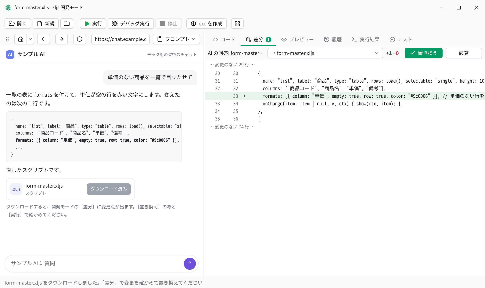
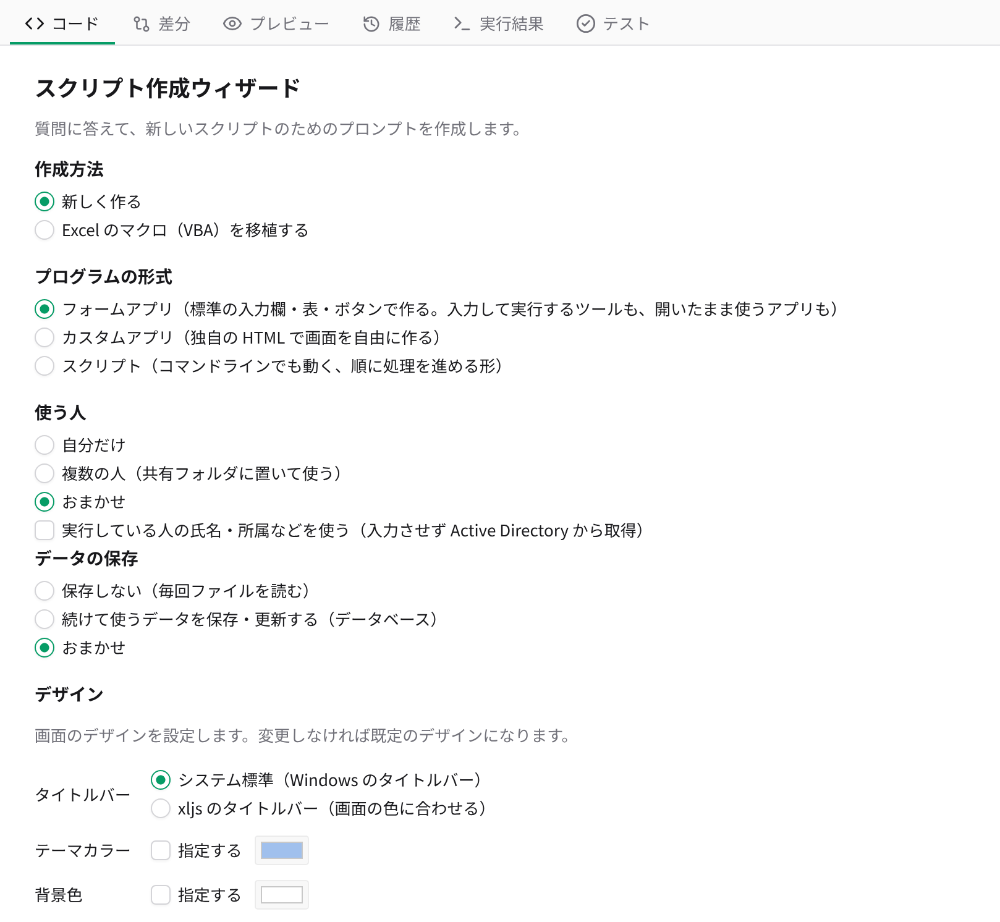
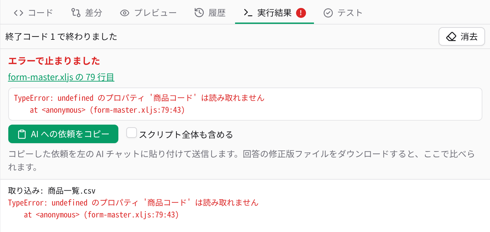
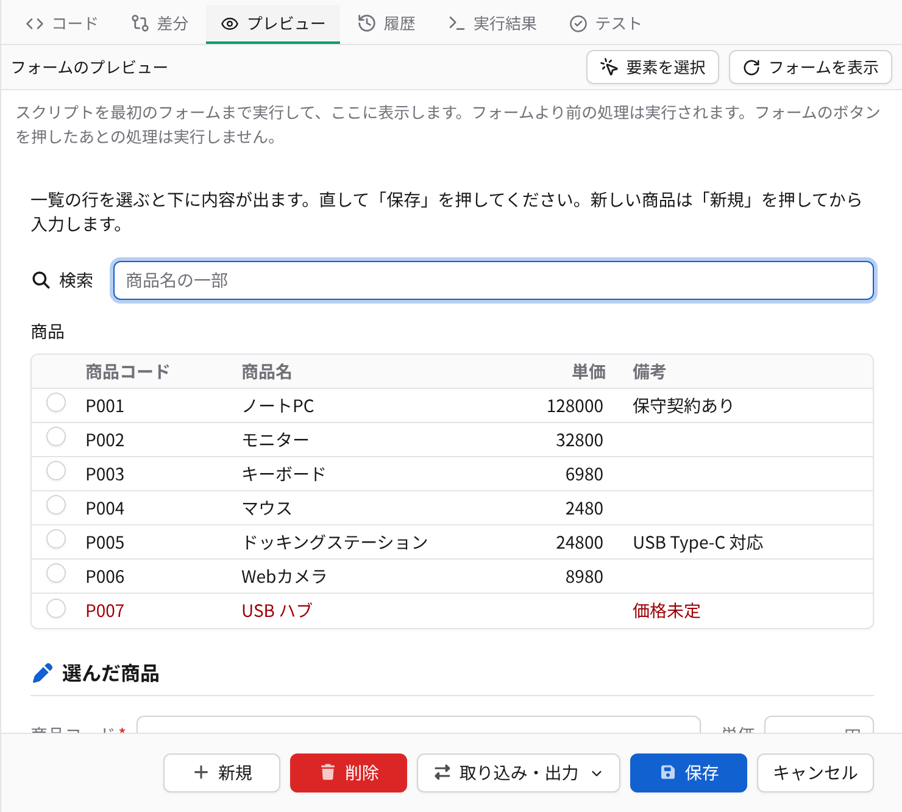
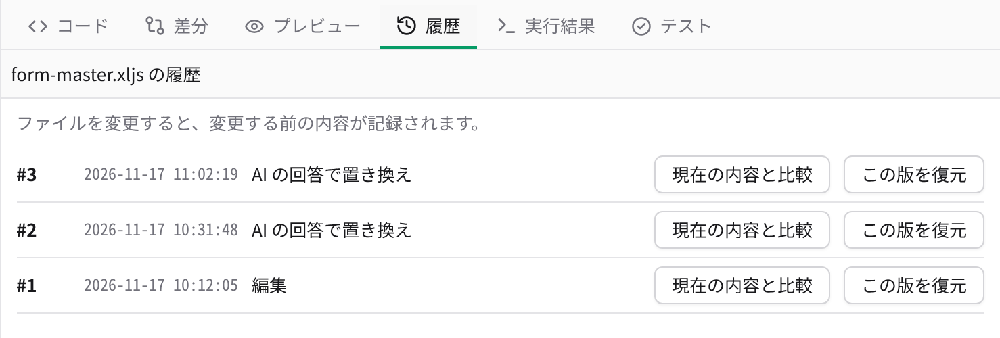
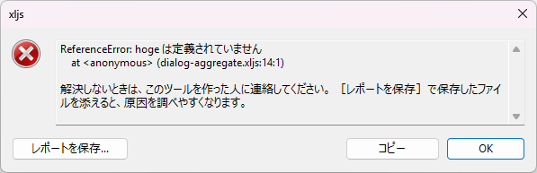

```
xljs dev 集計.js
```

開始画面の「開発モード」でも開きます。左に AI チャット（Microsoft Copilot・Microsoft 365 Copilot・Gemini・ChatGPT・Claude のボタンか URL で開く。サインインはそのまま残ります）、右にキャンバス（タブ: コード・差分・プレビュー・履歴・実行結果・テスト）が並ぶウィンドウです。API キーなどの設定は要りません。

<figure class="shot"><figcaption>左が AI チャット、右がキャンバス。チャットでダウンロードした回答の変更点が「差分」タブに出ています（画面はリファレンスサイト用のモックで、チャットは架空のものです）。</figcaption></figure>

## 使い方の流れ

1. ［プロンプト］で AI 向けの指示をコピーし、チャットに貼り付けて、続けて作りたいものを書いて送信する（新しく作るときは、下の新規作成ウィザードがプロンプトを作ります）。
2. AI の回答のファイルをダウンロードすると「差分」タブに変更点が出るので、確かめて［置き換え］を押す。
3. ［実行］（F5）で動かして確かめる。エラーになったら［AI への依頼をコピー］でチャットに直してもらう。
4. 直したい点があれば、チャットで続けて頼み、2・3 を繰り返す。置き換える前の内容は「履歴」に残るので、いつでも戻せます。

## 新しく作る（新規作成ウィザード）

<figure class="shot"><figcaption>［新規］→［AI チャットで新しく作る］で開くウィザード。質問に答えるとチャットに送るプロンプトができます。</figcaption></figure>

開始画面（スクリプトを開いているときは［新規］）の［AI チャットで新しく作る］［Excel のマクロを移植する］から、質問に答えて AI チャットに最初に送るプロンプトを作ります。聞くのは、新しく作るか Excel マクロの移植か、プログラムの形式（フォームアプリ＝標準の入力欄・表・ボタンで作る画面。入力して実行するツールも、開いたまま使うアプリも作れます／カスタムアプリ＝独自の HTML の画面／スクリプト＝画面を作らず順に処理を進める形）、使う人（自分だけ・複数の人）、データを保存するか、画面のデザイン、スクリプトの名前（決める・おまかせ）、作るフォルダ、作成したいものの内容（移植ならマクロからの変更点）。移植では、選んだブックからマクロ（VBA）とシートの構成（大きさ・表の位置・数式。同じ形の数式はまとめる）を取り出してプロンプトに入れ、入力・出力ファイルの有無と説明も聞きます。表の位置は、シートの上の方にタイトル・設定・集計があっても外さないように、テーブル、フィルター、同じ数式が縦に続く範囲、セルの並びの順に探し、見出しが何行目までか（結合セル・塗りつぶし・罫線から）と、複数の列にまたがる名前（列のグループ）も伝えます。「データの先頭の行」で選んだ行数だけ各表のデータを、あわせて表の外の行（20 行まで）を入れます。「含めない」にすると、表の位置と見出しだけになります。長くなるときは取り出した内容をテキストファイルに保存して添付できます。［スクリプトを作成してプロンプトをコピー］で仮のスクリプトを作って開き、プロンプトをコピーするので、チャットに貼り付けて送信します。名前を「おまかせ」「未定」にしたときは、AI の回答のファイルで置き換えるときにその名前に変えられます。

## AI チャットとのやりとり

- **プロンプト**: ドロップダウンから、AI 向けの指示（`docs/ai/prompt.md`）だけ（［開発開始用プロンプトをコピー］）、指示と今のスクリプト（［開発開始用プロンプトと今のスクリプトをコピー］）、今のスクリプトだけ（［今のスクリプトだけをコピー］）のいずれかをクリップボードにコピーします。チャットの最初に貼り付けて送信し、続けてやりたいことを書きます。
- **回答の取り込み**: チャットでダウンロードしたファイル（回答のコードのダウンロードボタン、または「ファイルで出して」と頼んだもの）は保存場所を聞かずに受け取り、「差分」タブで今のファイルと比べて表示します。［置き換え］で置き換わります（［破棄］で取り込みません）。置き換える先は、ふつうは編集中のスクリプトです。名前で選べるときは名前で選びます（AI が付けがちな後ろの文字は無視: `集計_修正版.js`・`集計 (1).js` → `集計.js`。アプリの `ui/index.html` なども `index_fixed.html` から分かります）。分からないときは選べます。

## 実行とエラー

- **実行**: ［実行］（F5）・［デバッグ実行］（Shift+F5）はスクリプトを別のプロセスで実行し、出力を「実行結果」に表示します。開発モードからの実行では、無限ループの確認（`--watchdog`・`--stop-key`）が常に有効になり、`fs.remove` がフォルダを中身ごと消すときと、1 回の実行で 2 つ目のファイルを消すときに確認します。
- **エラー・無限ループ**: 止まった場所（ファイルと行）を表示し、クリックでその行に移動します。［AI への依頼をコピー］で、エラーの内容・前後のコード・「修正した完全なファイルを同じ名前で」という依頼をまとめてコピーするので、チャットに貼り付けて送信します（「スクリプト全体も含める」も選べます）。無限ループで中止したときも、実行していた場所が分かります。

<figure class="shot"><figcaption>エラーで止まったときの「実行結果」タブ。行のリンクでその行に移動し、［AI への依頼をコピー］でチャットに貼る依頼文をコピーします。</figcaption></figure>

## プレビュー

アプリ（`@mode app`）は `@html` の画面の見た目を表示します（スクリプトは動きません）。それ以外は、スクリプトを最初のフォーム（`ui.form`）まで実行してフォームを表示します（フォームのボタンを押したあとの処理＝ボタンの `onClick` は実行しません。フォームより前のコードは実行されます）。

<figure class="shot"><figcaption>フォームのプレビュー。スクリプトを書き換えると表示し直します。</figcaption></figure>

## 履歴

置き換える前（AI の回答の適用・前の版に戻すとき・その回で初めて保存するとき）の内容を、スクリプトのフォルダの `.xljs/versions/<ファイル名>/0001.js`, `0002.js` … に残します。「履歴」タブの［現在の内容と比較］で違いを見たり、［この版を復元］で戻したりできます（復元した際も直前の内容が記録されます）。

<figure class="shot"><figcaption>「履歴」タブ。いつ、何で置き換えたかが並びます。</figcaption></figure>

## コードの編集

エディタ（CodeMirror。JavaScript・TypeScript・JSON・HTML・CSS の色分け、括弧の対応・自動で閉じる、折りたたみ、Ctrl+F で検索・置換、［整形］（Shift+Alt+F）で Prettier による整形。入力から 1.5 秒で自動保存、Ctrl+S でも保存）。xljs の API は入力補完が出ます（`ui.`・`wb.sheets[0].` のようなメンバー、`ui.form({ ` の中のオプション名、`for (const sheet of wb.sheets)` の変数など。Ctrl+Space でも出せます）。名前にマウスを置くと説明が出ます。ほかのエディタで変更したファイルは、ウィンドウに戻ったときに読み込み直します。

## テスト

「テスト」タブの［テストケースを記録］で、いつもの使い方をテストケースとして保存できます。AI の回答で置き換えるたびに自動で実行し、結果が変わったら知らせます（[テスト](test.md)）。

## 配布する前に

### 手順書を作る

記録したテストケースから、利用者向けの手順書を作れます。「テスト」タブでケースの［手順書を開く］を押すと、ケースを画面を出さずに実行し直して、操作した順に手順と画面の画像（入力した項目と押したボタンを赤い枠で囲んだもの）を並べます。説明を書き足し、デザインを選んで、Markdown・HTML・PDF で保存します。スクリプトを直したら、同じケースから作り直せば画像も新しくなります（[手順書を作る](test.md#手順書を作る)）。

### エラーのときの連絡先を書く

書いていないと、エラーの画面には「このツールを作った人に連絡してください」としか出ず、利用者は誰に聞けばよいか分かりません。

<figure class="shot"><figcaption>`@author`・`@contact` を書いていないときのエラーの画面。作った人の名前も連絡先も出ません。</figcaption></figure>

メタデータに `@author`（作成者）と `@contact`（連絡先）を書いておくと、利用者のパソコンでスクリプトがエラーで止まったとき、エラーの画面に「このツールの作成者 総務課 山田太郎（yamada@example.com）に連絡してください。」と表示します。

```js
// ==xljs==
// @title   売上集計ツール
// @author  総務課 山田太郎
// @contact yamada@example.com  // メールアドレス・URL・内線など
// ==/xljs==
```

`@contact` がメールアドレスなら［メールで連絡］で、エラーの内容を入れたメールを作れます（`https://` の URL なら［連絡先を開く］）。エラーを見るのはたいていスクリプトを作った人ではないので、配布するスクリプトには書いておくことをおすすめします。開発モードからの実行では、連絡先の案内は出ず、代わりに［AI への依頼をコピー］が出ます（[メタデータ](metadata.md)）。

## .xljs ファイル

`.xljs` ファイルも `.ts` と同じように開いて編集できます（関連付けていれば右クリックの「編集（開発モード）」で開きます。[.xljs ファイル](run.md#xljs-ファイルダブルクリックで実行)）。ファイル一覧からチャットへドラッグすると、決まった拡張子しか受け付けないチャットのために `.ts` の名前を付けたコピーを渡し、回答の `.ts` / `.js` のファイルは元の `.xljs` ファイルを置き換えます。

## チャットの設定

- **チャットの紐付け**: スクリプトごとに使ったチャットの URL を `.xljs/dev.json` に覚え、次にそのスクリプトを開くと同じ会話を開きます。
- **既定のチャット**: チャットを選ぶ画面で「選んだチャットを既定にする」にチェックして選ぶと、ホームボタン（家のアイコン）でそのチャットに戻り、チャットを紐付けていないスクリプトもそのチャットで開きます（既定はオフ）。ホームボタンの右の ▼ からは「AI チャットを選び直す」「今のページを既定のチャットにする」「既定のチャットを解除する」を選べます。下の配布用の既定より優先します。
- **画面の配置**: 右上のボタンで「両方」「AI チャットだけ」「キャンバスだけ」と左右の入れ替え。境目はドラッグで動かせます。

### 配布用の既定のチャット

`xljs.exe` と同じフォルダに `xljs.json` を置くと、開発モードを開いたときと、チャットを紐付けていないスクリプトを開いたときに、そのチャット（社内の Copilot エージェントなど）を開きます。チャットの選択肢に足すこともできます。

```json
{
  "dev": {
    "chat": "https://m365.cloud.microsoft/chat/?titleId=T_xxxxxxxx",
    "services": [
      { "name": "xljs 開発エージェント", "url": "https://m365.cloud.microsoft/chat/?titleId=T_xxxxxxxx", "icon": "m365" }
    ],
    "builtinServices": true
  }
}
```

`chat` は既定で開く URL、`services` はチャットの選択肢の先頭に足すもの（`icon` は `copilot`・`m365`・`gemini`・`openai`・`claude`、省略で吹き出し）、`builtinServices: false` で組み込みの選択肢（Copilot・Gemini など）を隠します。どれも省略できます。`chat` は選択肢になければ先頭に足されます（「ホーム」から戻れるように）。文字コードは UTF-8（BOM 可）。同じファイルの `userAgent`（`"edge"`（既定）・`"chrome"`）で、チャットの枠が名乗るブラウザ（このパソコンに入っている Edge か Chrome の User-Agent とクライアントヒント）を選べます（`fetch` も同じ。「Web API（`fetch`）」を参照）。

API での連携や Git との連携はしません（AI とのやりとりはチャット画面とファイルのダウンロード・クリップボードだけ）。仕組みは `docs/design/dev-mode.md`。
