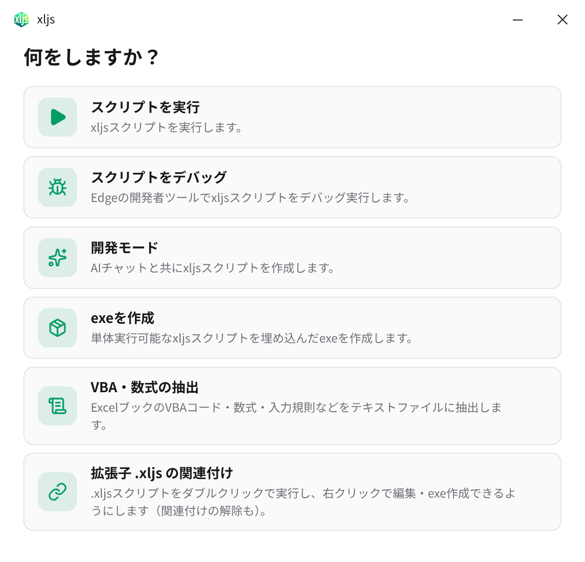
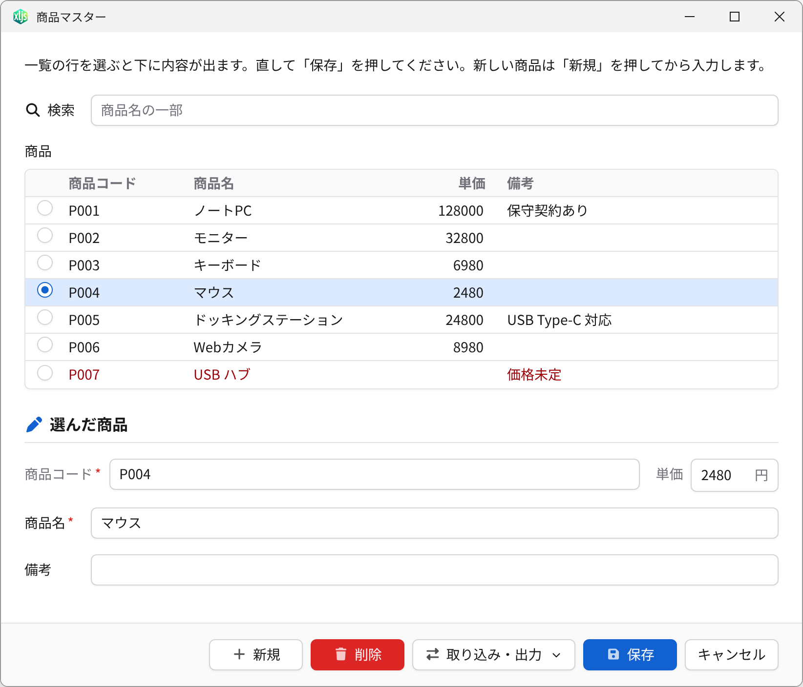
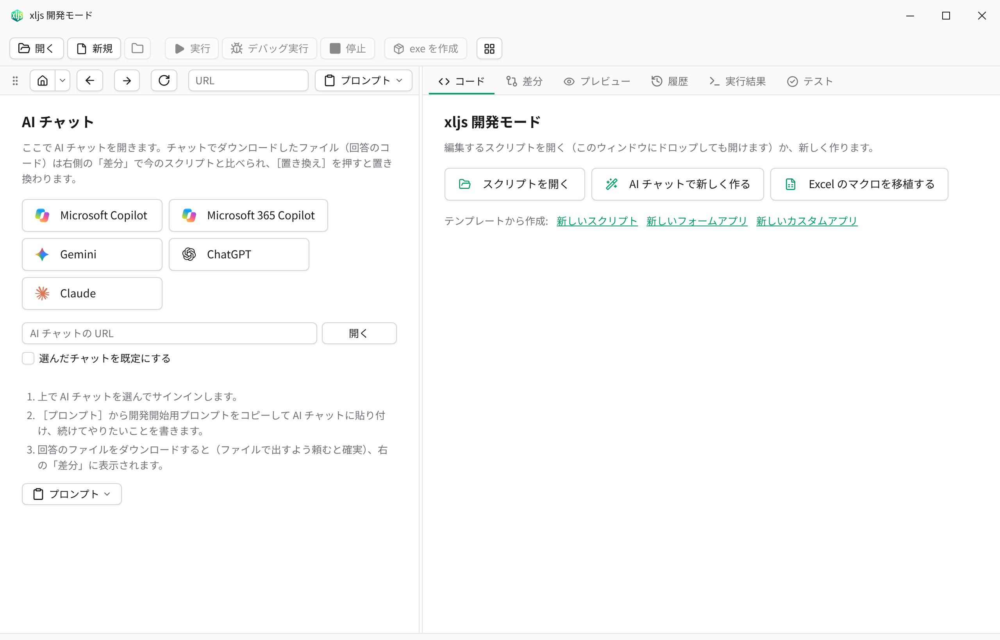
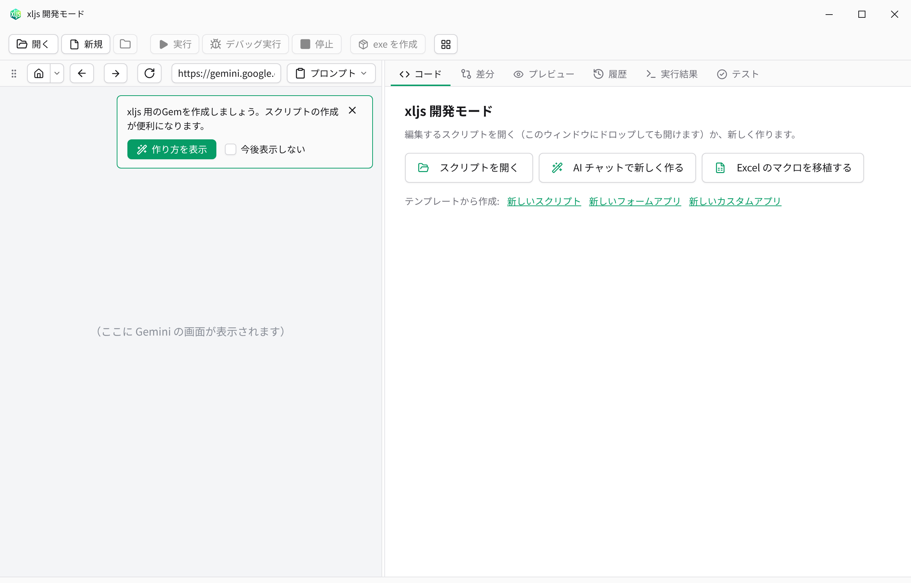
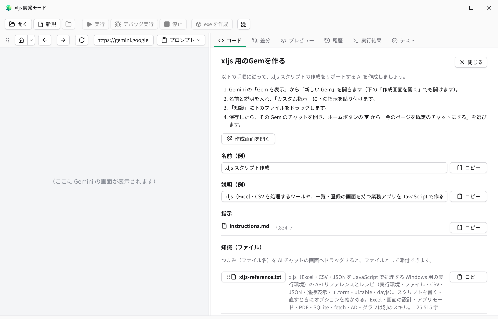
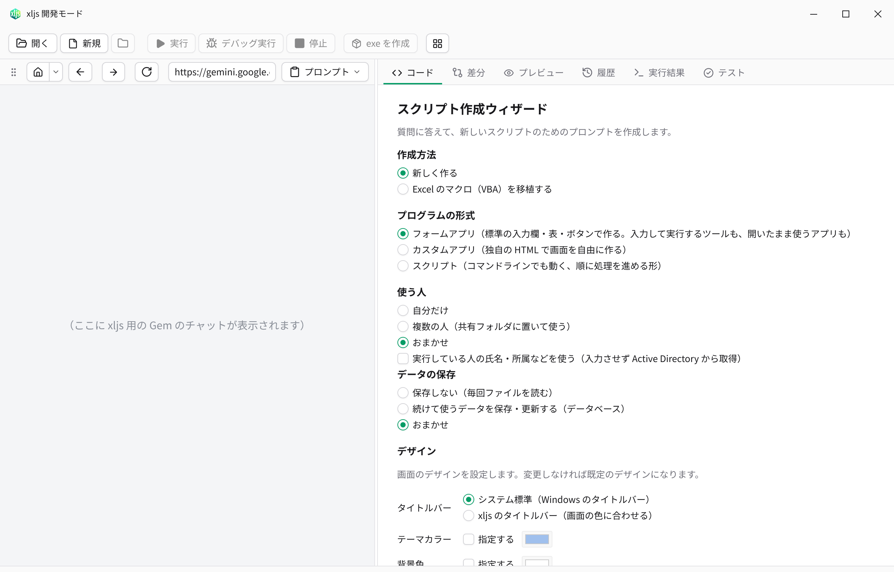
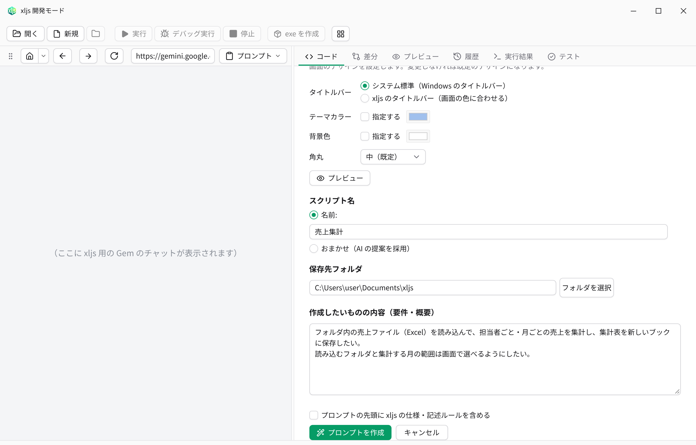

xljs をダウンロードしてサンプルを動かし、開発モードで AI チャットと一緒にスクリプトを作り始めるところまでを順に説明します。Excel・Node.js などのインストールは要りません。

## 1. ダウンロードして展開する

[GitHub の最新のリリース](https://github.com/cool0707/xljs/releases/latest)から [`xljs-windows-x64.zip`](https://github.com/cool0707/xljs/releases/latest/download/xljs-windows-x64.zip) をダウンロードします（ARM の Windows では [`xljs-windows-arm64.zip`](https://github.com/cool0707/xljs/releases/latest/download/xljs-windows-arm64.zip)）。

ダウンロードした zip を右クリックして「すべて展開」を選び、好きなフォルダ（ドキュメントの下など）に展開します。インストーラーはなく、展開したフォルダのまま使います。zip を開いただけの状態（展開せずに中を見ている状態）では動かないので、必ず展開してください。

```
xljs-windows-x64\
├─ xljs.exe     ふだん使う実行ファイル（GUI 版）
├─ xljsc.exe    コマンドプロンプト用の実行ファイル（コンソール版）
├─ prompt\      AI チャットに渡す資料
└─ examples\    サンプルのスクリプトと、試すためのデータ（data\）
```

### xljs.exe と xljsc.exe

2 つの中身は同じで、違うのは起動のしかただけです。

- **xljs.exe**（GUI 版）: ダブルクリックやファイルのドロップで使います。黒いコンソールの画面は出ません。ふだんはこちらを使います。
- **xljsc.exe**（コンソール版）: コマンドプロンプトや PowerShell、バッチファイルから使います。終わるまで待ち、出力をコンソールに書くので、リダイレクトやタスクスケジューラでの実行に向いています。

詳しくは [実行ファイルと引数](run.md) を参照してください。

> 初めて起動したときに「Windows によって PC が保護されました」と表示されたら、「詳細情報」を押してから「実行」を押します。

## 2. xljs を起動する

`xljs.exe` をダブルクリックすると、次の開始画面が開きます。

<figure class="shot"><figcaption>開始画面。ここから実行・開発モード・exe の作成などを選びます</figcaption></figure>

## 3. 拡張子 .xljs を関連付ける（しなくてもかまいません）

xljs のスクリプトは拡張子 `.xljs` のファイルです。開始画面の「拡張子 .xljs の関連付け」を押し、確認に答えると、`.xljs` ファイルが xljs で開くようになります。

- **ダブルクリック**でスクリプトを実行します。
- **右クリック**の「編集（開発モード）」で開発モード、「exe を作成」で配布用の exe を作れます（Windows 11 では「その他のオプションを確認」の中）。
- `.xljs` ファイルにファイルをドロップすると、そのファイルを渡して実行します。

変更するのは今の Windows アカウントの設定だけで、管理者の権限は要りません。

関連付けは**しなくても使えます**。その場合は、開始画面の「スクリプトを実行」でスクリプトを選ぶか、スクリプトを `xljs.exe` にドラッグ＆ドロップして実行します。会社のパソコンで設定を変えたくないときや、ほかの人のパソコンで一度だけ使うときは、関連付けずに使ってください。あとから関連付けたり解除したりもできます（開始画面で同じボタンを押すと、関連付け済みなら解除するか尋ねます）。

`xljs.exe` を別のフォルダに移したときは、関連付け直してください。

## 4. サンプルを動かす

`examples` フォルダのサンプルを動かしてみます。ここでは商品マスターを管理するアプリ `form-master.xljs` を使います。

1. 関連付けたなら `examples\form-master.xljs` をダブルクリックします。関連付けていないなら、開始画面の「スクリプトを実行」を押して `examples\form-master.xljs` を選びます。
2. 商品マスターの画面が開きます。最初は一覧が空なので、［取り込み・出力］→［CSV から取り込み］を押し、`examples\data\商品一覧.csv` を選びます。
3. 一覧に商品が並びます。行を選ぶと下の入力欄に内容が出て、直して［保存］を押すと一覧に反映されます。上の検索欄に商品名の一部を入れると絞り込めます。

<figure class="shot"><figcaption>examples/form-master.xljs。HTML を書かずに、一覧・検索・登録の画面を作れます</figcaption></figure>

データは `examples` フォルダの `商品マスター.db`（SQLite のデータベース）に保存されます。閉じてもう一度開くと、続きから使えます。

ほかのサンプルと、それぞれで試すデータは [サンプル](examples.md) にまとめています。ファイルやフォルダを選ぶサンプルは、選ぶ画面のタイトルに試すデータ（`data\売上` など）が書いてあります。

## 5. 開発モードを開く

自分のスクリプトは、開発モードで AI チャットに頼んで作ります。開始画面の「開発モード」を押すと、次の画面が開きます。

<figure class="shot"><figcaption>左が AI チャット、右がスクリプトの画面です</figcaption></figure>

左で、ふだん使っている AI チャットを選んでサインインします。チャットは開発モードの中で開き、サインインは次回も残ります。会社で使えるチャットが決まっているなら、それを選んでください。下の欄に URL を入れて開くこともできます。

## 6. xljs 用のエージェント・Gem を作る

Microsoft 365 Copilot・Gemini・ChatGPT・Claude では、xljs の書き方をあらかじめ覚えさせた専用の AI（Microsoft 365 Copilot はエージェント、Gemini は Gem、ChatGPT は GPT、Claude はプロジェクト）を作れます。一度作っておけば、毎回 xljs の資料を貼り付けなくても正しい書き方で答えるようになります。

ここでは Gemini の Gem を例にします。Gemini を選んでサインインすると、チャットの上に「xljs 用の Gem を作成しましょう」と表示されます。

<figure class="shot"><figcaption>Gem・エージェントを作れるチャットを開くと表示されます</figcaption></figure>

［作り方を表示］を押すと、右に手順と、Gem に入れるもの（名前・説明・指示・知識のファイル）が表示されます。

<figure class="shot"><figcaption>手順に従って、左のチャットの画面で Gem を作ります</figcaption></figure>

1. ［作成画面を開く］を押すと、左に Gemini の Gem の作成画面が開きます。
2. 名前と説明の［コピー］を押して、作成画面のそれぞれの欄に貼り付けます。
3. 「指示」の［コピー］を押して、作成画面の「カスタム指示」に貼り付けます。
4. 「知識（ファイル）」の各ファイルを、左のつまみ（ファイル名）を持って作成画面の「知識」へドラッグします。
5. 保存したら、作った Gem のチャットを開き、チャットの上のホームボタン（家のアイコン）の ▼ から「今のページを既定のチャットにする」を選びます。次からは開発モードを開くとこの Gem のチャットが開きます。

ほかのサービスでも、同じ画面に表示される手順で作れます。案内を閉じたあとでも、チャットの上の［プロンプト］のメニューの「xljs 用の Gem を作る（Gemini）」などから開けます。

Microsoft Copilot（無料版）のように専用の AI を作れないチャットでは、作らずにそのまま使います。その場合は、チャットの最初に［プロンプト］の「開発開始用プロンプトをコピー」で xljs の資料をコピーして貼り付けます（次のウィザードでは「プロンプトの先頭に xljs の仕様・記述ルールを含める」にチェックします）。

## 7. ウィザードで作り始める

右の［AI チャットで新しく作る］を押すと、新規作成のウィザードが開きます。質問に答えると、AI チャットに最初に送るプロンプト（依頼文）を作ります。

<figure class="shot"><figcaption>わからない質問は「おまかせ」のままでかまいません</figcaption></figure>

- **作成方法**: 新しく作るか、Excel のマクロ（VBA）を移植するか。
- **プログラムの形式**: 迷ったら「フォームアプリ」を選びます。入力して実行するツールも、上のサンプルのような開いたまま使うアプリも作れます。
- **使う人・データの保存・デザイン**: わかる範囲で選びます。「おまかせ」なら AI が内容に合わせて決めます。

下に進み、スクリプトの名前と保存先のフォルダを決めて、「作成したいものの内容」にやりたいことを書きます。何を読み込んで、何をして、何を出力したいかを、ふだんの言葉で具体的に書くのがコツです。

<figure class="shot"><figcaption>作りたいものの内容を書いて［プロンプトを作成］を押します</figcaption></figure>

［プロンプトを作成］を押すとプロンプトが表示されます。［スクリプトを作成してプロンプトをコピー］を押し、左の AI チャットに貼り付けて（Ctrl+V）送信します。AI の回答のファイルをダウンロードすると、右の「差分」で今のスクリプトと比べて置き換えられます。

ここから先の、回答の取り込み・実行・エラーの直し方は [開発モード](dev-mode.md) を、AI チャットに渡す資料の詳しい使い方は [AI チャットでスクリプトを作る](ai-chat.md) を参照してください。
