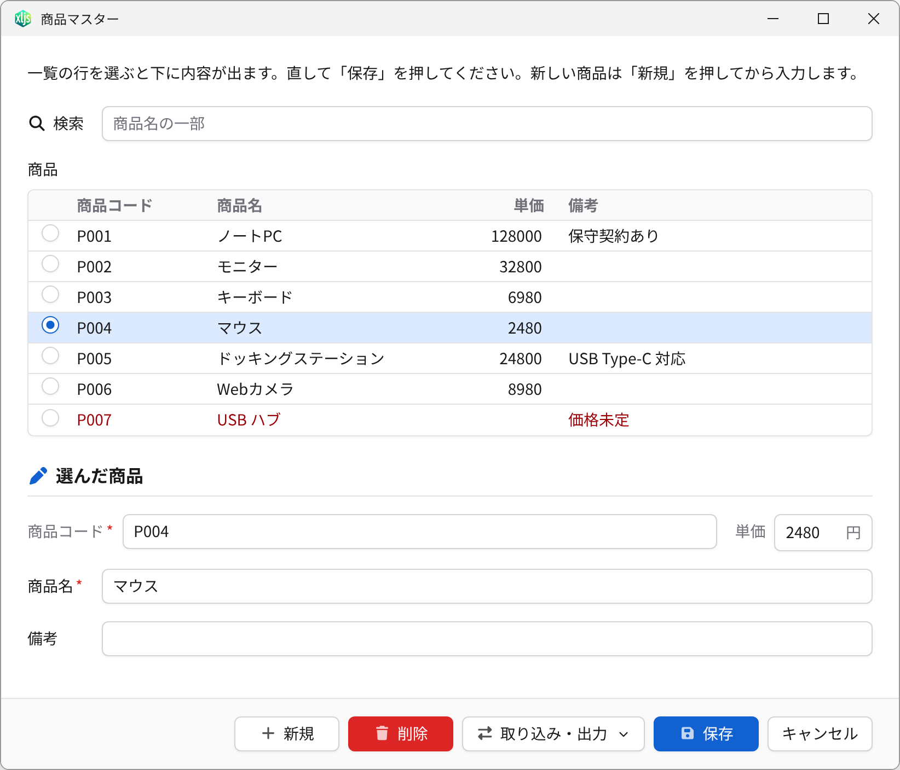
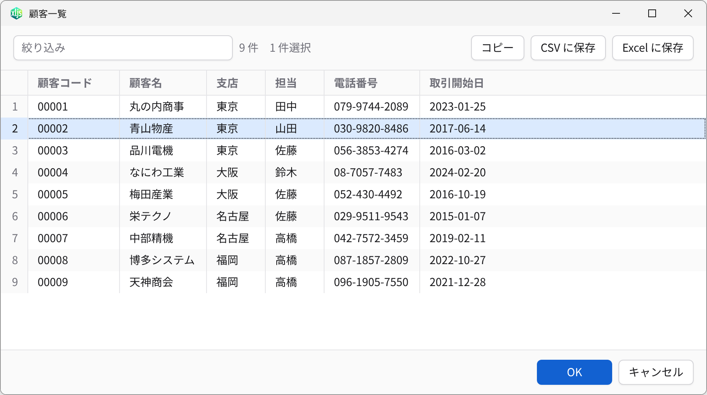
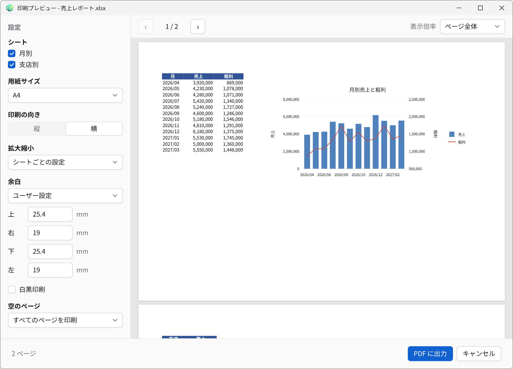

<section class="hero">
<div class="badges"><span class="badge strong">Windows 用のシングルバイナリ</span><span class="badge">Excel・Acrobat・Node.js 不要</span></div>
<h1 class="hero-title">JavaScript / TypeScript で、<br>Excel・PDF・業務の画面まで。</h1>
<p class="lead">Excel・CSV の集計やデータ変換、Excel で印刷したときと同じページの PDF 出力を、スクリプト 1 本で行います。入力して実行するツールから、一覧・検索・登録の画面を持つ業務アプリまで、HTML を書かずに作れます。作ったものは exe にして配れます。</p>
<p class="cta"><a class="button primary" href="guide/first-steps.md">ファーストステップ</a><a class="button" href="#開発モードのイメージ">開発モードのイメージ</a><a class="button" href="guide/examples.md">サンプル</a></p>
</section>

## 開発モードのイメージ

開発モード（`xljs dev`）は、AI チャットとスクリプトを並べて作る画面です。AI に頼んで、返ってきたスクリプトの差分を見て置き換え、その場で実行します。下は開発モードの動きをブラウザで確認できるモックです（実際にブラウザで動くアプリではありません）。画面は開発モードと同じものですが、左の AI チャットは架空のもので、決まった答えを返します。

<div class="demo" data-demo-page="demo/web/dev-demo.html">
<div class="demo-frame"><button type="button" class="demo-start">モックを開く</button></div>
</div>

<ol class="demo-steps">
<li>左のチャットで「単価のない商品を一覧で目立たせて」を押す</li>
<li>返ってきた <b>form-master.xljs</b> の［ダウンロード］を押す → 右に［差分］が出る</li>
<li>［置き換え］を押してから、上の［実行］で画面を開く（一覧の行を選ぶと下に内容が出ます）</li>
</ol>

実際の開発モードでは、Copilot・Gemini・ChatGPT・Claude など普段使っている AI チャットを左の枠で開きます。詳しくは[開発モード](guide/dev-mode.md)へ。

## スクリプト画面のサンプル

JavaScript のオブジェクト定義だけで、フォーム画面・表・グラフを表示できます。

<div class="gallery">
<div class="tabs" role="tablist"><button type="button" role="tab" aria-selected="true">フォームアプリ</button><button type="button" role="tab">表</button><button type="button" role="tab">グラフ</button><button type="button" role="tab">印刷プレビュー</button></div>
<figure role="tabpanel"><figcaption><code>ui.form</code> の一覧・検索・登録の画面（examples/form-master.xljs）。開いたまま使うアプリも、入力して実行するツールも作れます。→ <a href="api/form.md">フォーム</a></figcaption></figure>
<figure role="tabpanel" hidden><figcaption><code>ui.table</code> の表（CSV を読んで表示）。並べ替え・絞り込み・列の固定・コピーができ、選んだ行がスクリプトに返ります。→ <a href="api/table.md">表</a></figcaption></figure>
<figure role="tabpanel" hidden><figcaption><code>ui.chart</code> のグラフ。Excel のブックにあるグラフもそのまま表示できます（examples/chart-sales.xljs）。→ <a href="api/chart.md">グラフ</a></figcaption></figure>
<figure role="tabpanel" hidden><figcaption><code>book.printPreview</code> の印刷プレビュー。ブックの印刷の設定どおりのページを確かめてから、印刷や PDF 出力ができます（examples/xlsx-print-preview.xljs）。→ <a href="api/pdf-output.md">PDF 出力・印刷</a></figcaption></figure>
</div>

## 主な特徴

<div class="cards">
<div class="card"><h3>置くだけで動く</h3><p>実行ファイル 1 つで動きます。Excel・Acrobat・Node.js などのインストールは要りません。</p></div>
<div class="card"><h3>JavaScript / TypeScript</h3><p>ES2023 相当と TypeScript をそのまま実行します。<code>xljs init</code> の型定義でエディタの補完も効きます。</p></div>
<div class="card"><h3>Excel・PDF・CSV・SQLite</h3><p>xlsx の読み書きと数式の計算、印刷どおりの PDF 出力と PDF の編集、Shift_JIS の CSV、ファイルサーバーで共有する SQLite。</p></div>
<div class="card"><h3>AI チャットで作って exe で配る</h3><p>開発モードで AI チャットに頼んで作り、テストを記録して、exe にパックして配れます。</p></div>
</div>

## スクリプトの例

フォルダ内の Excel ファイルの「明細」シートを 1 つのブックに集めます。

```js
const dir = await showDirectoryPicker();
if (!dir) exit();

const rows = [];
for (const h of ui.withProgress(dir.walk("*.xlsx"), { title: "集計中" })) {
  const book = workbooks.open(h);
  for (const r of book.sheets["明細"]?.toObjects() ?? []) rows.push({ ...r, ファイル: h.relativePath });
}

const dest = await showSaveFilePicker({ suggestedName: "集計結果.xlsx" });
if (dest) {
  const out = workbooks.create();
  out.addSheet("明細").write(rows);
  out.save(dest);
  alert(`${rows.length} 件を集計しました`);
}
```

- **言語**: ES2023 相当（オプショナルチェーン、`??`、async/await、トップレベル await、クラスフィールドなど）と TypeScript。`import` でファイル分割可能
- **ファイル操作**: ブラウザの File System Access API 風（`showOpenFilePicker` / `FileSystemFileHandle` など）＋ フォルダ走査などの独自拡張
- **Excel**: xlsx の読み書き（[umya-spreadsheet](https://github.com/MathNya/umya-spreadsheet)）。値は数値・文字列・真偽値・`Date` で受け渡し
- **PDF**: Excel で印刷したときと同じページでの PDF 出力（WebView2）、PDF の結合・ページの削除・挿入・回転・文字の追加（Excel・Acrobat 不要）
- **CSV / JSON**: Shift_JIS(CP932) / UTF-8 の自動判定、BOM 付き UTF-8 での書き出し、JSON Lines
- **エクスプローラー連携**: 出力したファイルを選択した状態でエクスプローラーを開く、既定のアプリで開く
- **UI**: Windows ネイティブのダイアログ（メッセージボックス、ファイル選択、進捗ダイアログ）、フォーム（HTML を書かずに作る画面。入力して実行するツールから、一覧・登録のあるアプリまで）・表・グラフ・HTML の画面（WebView2）。コンソールでも動作
- **その他**: SQLite（ファイルサーバーでの共有も）、Web API（`fetch`）、Active Directory、プログラムの実行、exe へのパック、VBA マクロ・数式の取り出し

## このサイトの読み方

- [ファーストステップ](guide/first-steps.md): ダウンロードからサンプルの実行、開発モードで AI チャットと作り始めるまで
- [実行ファイルと引数](guide/run.md): xljs.exe と xljsc.exe、コマンドとオプション、.xljs ファイル
- [サンプル](guide/examples.md): 機能ごとのサンプルスクリプト
- [AI チャットでスクリプトを作る](guide/ai-chat.md): Claude・Gemini・Copilot などに書いてもらうための資料
- API: 左の目次から機能ごとのページへ。各ページの「リファレンス」は型定義（[`xljs.d.ts`](../../types/xljs.d.ts)）から作っているので、オプションの名前と型はここが正確です。上の検索欄で `ui.form` や `Worksheet.toPdf` のように引けます。

型定義は `xljs init` でスクリプトのフォルダに出力できます（[エディタの補完](guide/editor.md)）。
